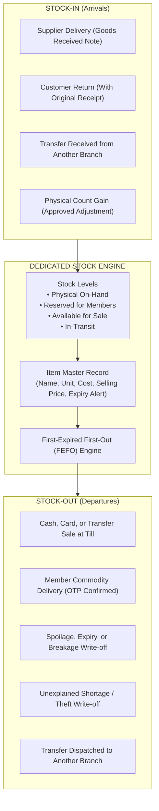
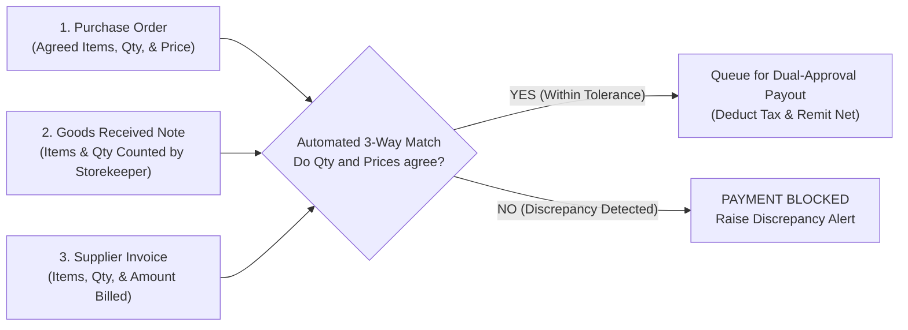
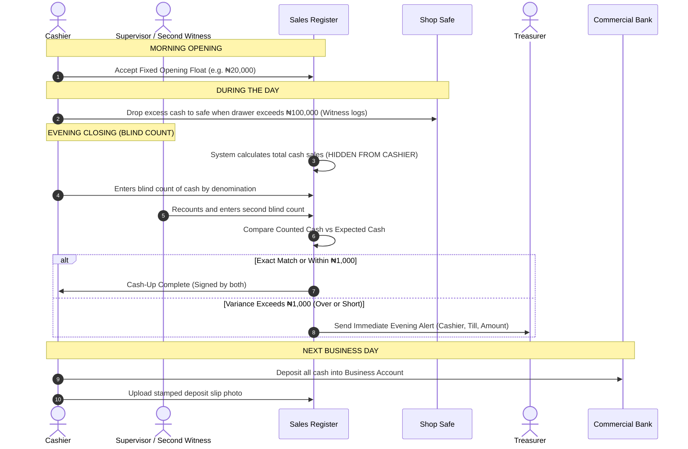
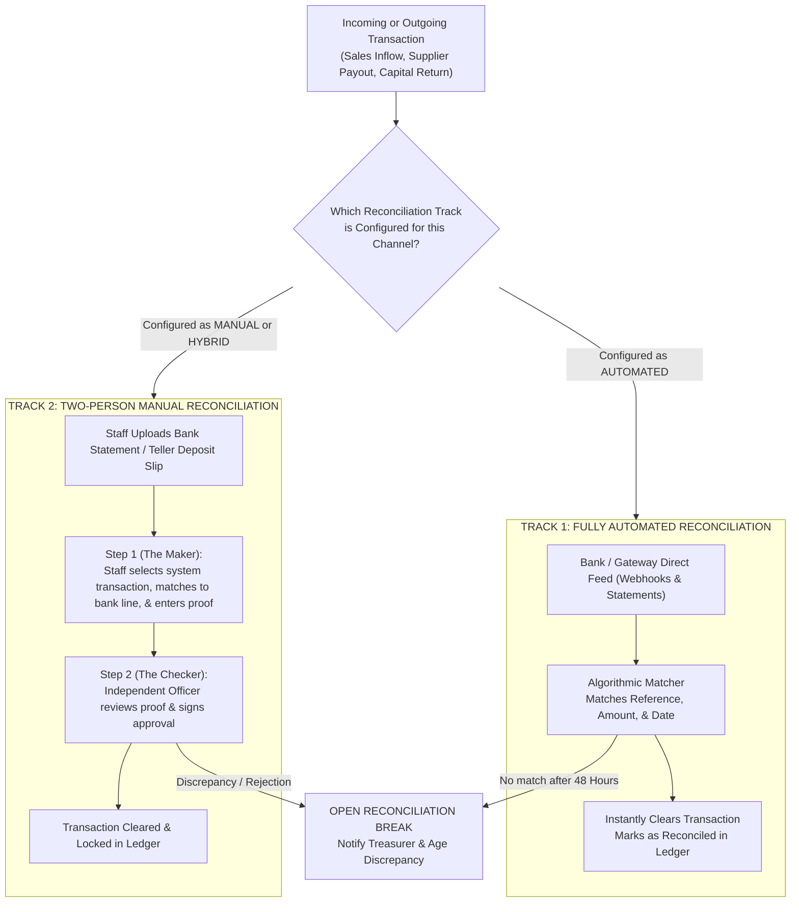
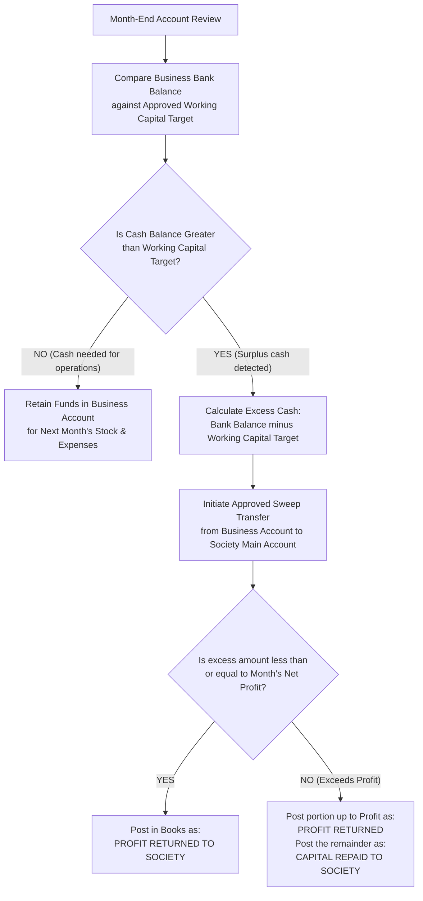

# Functional Requirements Document (FRD): Cooperative Business Ventures & Trading Operations

**Document Version:** 1.0  
**Date:** October 11, 2026  
**Audience:** Cooperative Executives, Board of Directors, Supervisory Committees, Business Managers, Accountants, and Auditors.  
**Language Standard:** Clear Plain English (Non-Technical). No programming code or software jargon.

---

## 1. Executive Summary and Guiding Philosophy

### 1.1 The Cardinal Rule: Ring-Fencing Member Savings
The single most important rule of this system is that **a cooperative’s commercial business must never use, risk, or mix with the withdrawable savings of its members**. 

When cooperatives fail or collapse, it is almost always because money saved by members was quietly pulled out of savings accounts to buy retail stock, fund real estate, or cover shop losses. Under this system:
* Every business venture operates as its own separate business unit.
* Every venture has its own approved capital ceiling, its own dedicated bank account in the society’s name, and its own separate accounting books.
* Sales money from a shop, petrol station, or transport vehicle can **never** be deposited into the account where member savings are kept.
* Money can only move from the main cooperative account into the business account through formal, approved capital tranches.
* Every single naira is tracked from the moment capital leaves the main account until it returns as earned profit or repaid capital.

### 1.2 Key Highlights of this Specification
Based on practical operational realities, this document defines four core business capabilities:
1. **Two Ways to Reconcile Payments (Automated and Manual):** Where modern banking and card machines are available, the system matches incoming and outgoing money automatically. Where banking connections are offline or local banks only provide paper receipts and bank statements, the system provides a strict, two-person manual reconciliation process with uploaded photo evidence.
2. **Dedicated Stock Management Module:** A complete, standalone system for tracking stock levels in real time, handling stock arriving from suppliers (Stock-In), and tracking stock leaving through sales, transfers, spoilage, or theft (Stock-Out).
3. **Dedicated Inflow and Outflow Reconciliation and Reporting Module:** An independent module that proves that every naira coming in and going out matches the bank statement. This check can be set to run **Daily, Weekly, or Monthly**, depending on how the business operates.
4. **Completely Configurable Workflows:** Every single approval limit, review threshold, schedule, and tolerance percentage can be customized by the cooperative board for each specific business venture without needing to rewrite any system rules.

---

## 2. Who Does What: Roles and Separation of Duties

To prevent theft, fake records, and mistakes, no single person is allowed to control money or goods from start to finish. The system strictly enforces the following roles and rules.

### 2.1 The Roles and Their Responsibilities

| Role | What They Must Do | What They Are Strictly Forbidden From Doing |
| :--- | :--- | :--- |
| **General Meeting (All Members)** | Approves the creation of any business venture, sets the maximum capital ceiling, and decides how year-end profits are shared. | Cannot get involved in everyday buying and selling. |
| **Board of Directors** | Approves the detailed business plan, sets spending budgets, appoints committees, and reviews monthly business results. | Must never run daily shop counters or handle till cash. |
| **Business Committee** | Oversees the day-to-day business, checks supplier price quotes, and approves purchases above the manager's limit. | Cannot approve claims, payments, or purchases for themselves or their relatives. |
| **Business Manager** | Runs daily operations, monitors stock, requests new stock purchases, sets retail prices within board policy, and reviews daily reports. | Cannot hold cash drawers, cannot count stock alone, and cannot approve payouts for orders they created. |
| **Cashier / Sales Attendant** | Rings up sales, collects payments (cash, card, bank transfer), and counts the cash drawer at the end of the shift with a witness. | Cannot receive stock deliveries from suppliers, cannot count stock alone, and cannot approve refunds. |
| **Storekeeper** | Inspects and receives deliveries from suppliers, counts physical items, checks expiry dates, and keeps warehouse records. | Cannot operate sales tills and cannot collect money from customers. |
| **Treasurer** | Releases approved capital, makes approved bank transfers to suppliers, and checks bank balances against the books. | Cannot create the purchase orders they are asked to pay. |
| **Supervisory Committee / Internal Auditor** | Conducts surprise cash drawer counts, runs unannounced stock checks, and investigates any money differences. | Cannot take part in any operational buying, selling, or paying. |
| **External Auditor** | Examines the year-end books of the business unit to confirm they are accurate and truthful. | Has read-only access to all transactions and receipts. |

### 2.2 Unbreakable Separation Rules
The system will automatically refuse to let a user perform an action if it violates any of these seven basic safety rules:
* **Rule 1 (No Sales + Receiving):** The same person cannot ring up sales on a till and also sign for stock deliveries from suppliers.
* **Rule 2 (No Self-Approval of Purchases):** The person who requests a purchase cannot be the person who approves the purchase order or pays the supplier's bank account.
* **Rule 3 (No Solo Cash Counts):** A cashier can never count their own till alone at closing; a second person must always recount and co-sign.
* **Rule 4 (No Cash Handlers Doing Bank Reconciliation):** A cashier or storekeeper is never allowed to match bank statements or reconcile the business accounts.
* **Rule 5 (Related-Party Protection):** A committee member cannot approve a purchase from a supplier who is their family member or business partner.
* **Rule 6 (Supplier Master Protection):** The person who adds a new supplier or changes a supplier’s bank account details cannot approve the first payment to that supplier.
* **Rule 7 (Stock Count Independence):** No worker can count stock that they issued or received on the same day unless an independent auditor watches and co-signs.

---

## 3. Configurable Process Workflow Engine

Every business venture is different. A foodstuff commodity scheme, a supermarket, a fuel station, and a transport bus operate on different timelines and financial volumes. 

Therefore, **every workflow in the system is completely configurable**. The board of directors sets these parameters when creating the venture, and can adjust them later with formal board approval.

### 3.1 Master List of Configurable Settings

| Setting Name | What It Controls | Standard Default Setting |
| :--- | :--- | :--- |
| **Manager Spending Limit** | The maximum purchase amount a business manager can approve on their own. | ₦200,000 |
| **Committee Spending Limit** | The maximum purchase amount the business committee can approve without needing the full board. | ₦2,000,000 |
| **Three-Quote Threshold** | Any purchase above this amount must have three competing price quotes attached. | ₦500,000 |
| **Supplier Bank Cooling-Off Period** | Hours the system waits before allowing payments to a supplier after their bank details were changed. | 24 Hours (or 72 Hours for high-risk ventures) |
| **Anti-Splitting Window** | Days the system looks back to detect if large orders were split into small orders to bypass limits. | 30 Days |
| **Reconciliation Schedule (Cadence)** | How often the business proves its cash and bank balances: **Daily, Weekly, or Monthly**. | Daily for retail shops; Weekly for transport; Monthly for commodity schemes. |
| **Payment Reconciliation Mode** | Whether matching is **Automated, Manual, or a Hybrid of both**. | Configured per payment channel. |
| **Cash Over/Short Tolerance** | Allowed daily difference between counted till cash and recorded sales before raising an emergency alert. | ₦1,000 per till |
| **Banking Deadline** | The maximum time allowed before physical cash in the shop safe must be deposited in the bank. | Next business day |
| **Stock Shrinkage Tolerance** | The maximum acceptable loss from damage, expiry, or missing goods as a percentage of sales. | 1.5% of total monthly sales |
| **Stock Valuation Rule** | How the system calculates the value of unsold goods: **First-In First-Out (FIFO)** or **Weighted Average**. | First-In First-Out (FIFO) |
| **Expiry Warning Notice** | How many days before an item expires that the system must warn the manager to discount or return it. | 30 Days |
| **Working Capital Reserve Target** | How much cash the business is allowed to keep in its account before sweeping extra profits to the society. | Total Stock Value + 1 Month of Operating Expenses |
| **Monthly Reporting Deadline** | The working day of the new month by which the full financial pack must be ready for the board. | 5th working day of the month |

---

## 4. Module 1: Venture Setup and Capital Governance

### 4.1 Business Purpose
This module ensures that no business venture begins, and no cooperative money is spent, without a formal vote by members and a strict legal ring-fence.

### 4.2 Step-by-Step Workflow
1. **The Proposal:** The business committee submits a detailed business plan showing what will be sold, start-up costs, expected monthly expenses, profit margins, and how many months it will take to recover the capital.
2. **General Meeting Approval:** Members at a general meeting vote to approve the venture and establish a strict **Capital Ceiling** (for example, ₦10,000,000). The resolution date, member quorum, and exact voting results are permanently recorded in the system.
3. **Opening the Business Bank Account:** A separate bank account is opened in the registered name of the cooperative society (for example, *"Harmony Cooperative Society - Supermarket Account"*). The system checks the bank account title. If the account belongs to a private individual or is the society's general savings account, the system refuses to link it.
4. **Releasing Capital in Tranches:** The full capital ceiling is never handed over all at once. The treasurer releases money in stages (tranches) based on actual project milestones.
5. **The Ceiling Guard:** The system monitors every release. If a requested tranche would cause total releases to exceed the approved ceiling, the system completely blocks the transfer.

### 4.3 User Stories and Acceptance Criteria
* **Story:** *As a cooperative member, I want the system to block any venture spending that members did not approve, so that my savings are never gambled away.*
  * **Test 1:** Given a new business proposal without an attached general meeting resolution, when anyone attempts to release money, the system blocks the release.
  * **Test 2:** Given an approved ceiling of ₦10,000,000 where ₦8,000,000 has already been released, when the treasurer attempts to release ₦3,000,000, the system blocks the request and shows that only ₦2,000,000 of the ceiling remains.

---

## 5. Module 2: Dedicated Stock Management (Stock-In, Stock-Out, and Stock Levels)

### 5.1 Business Purpose
Physical stock represents cash sitting on warehouse shelves. This dedicated module tracks every single item entering, resting within, or leaving the business, ensuring that no stock goes missing without being detected.

### 5.2 Stock Levels Tracked
For every product, the system calculates four distinct quantities in real time:
1. **Physical On-Hand:** The exact number of items physically sitting in the store or warehouse.
2. **Reserved Stock:** Items that members have ordered and paid for (or had approved on credit) that are waiting to be picked up. These cannot be sold to anyone else.
3. **Available for Sale:** Physical On-Hand minus Reserved Stock. This is what cashiers are allowed to sell at the counter.
4. **In-Transit:** Stock that has left one cooperative shop and is currently on a delivery vehicle travelling to another branch.

### 5.3 Stock-In Procedures (How Stock Arrives)
* **Supplier Deliveries:** When goods arrive from a supplier, the storekeeper counts every item, inspects its physical condition, and enters the batch number and expiry date into a **Goods Received Note**. 
* **Partial Deliveries:** If a supplier only delivers 80 bags of rice out of an ordered 100 bags, the system increases stock by exactly 80 bags and keeps the purchase order open for the remaining 20 bags.
* **Customer Returns:** If a customer brings back unopened or defective goods, the storekeeper can only accept them if the manager approves and the original sales receipt is provided. The stock is returned to inventory only if it is in resalable condition; otherwise, it is logged directly to damaged goods.

### 5.4 Stock-Out Procedures (How Stock Leaves)
* **Sales at the Counter:** The moment a cashier finishes ringing up a sale and confirms payment, the system immediately reduces the stock count.
* **Member Credit Delivery:** For goods ordered on salary credit, stock is not deducted when the member places the order (it is only reserved). Stock is formally deducted only when the goods are physically handed over and the member provides their one-time secret delivery code.
* **Damaged, Expired, or Broken Goods:** If goods spoil, break, or expire, they cannot simply be thrown away. A formal **Stock Spoilage Form** must be submitted stating the product, batch number, reason, and photo evidence. The manager must approve, and the value of the lost goods is logged as an operating expense.

### 5.5 Stock Audits and Counting Rules
* **First-Expired First-Out (FEFO):** Products with the earliest expiry dates must be sold first. If an item is within the configured warning window (e.g., 30 days before expiry), the system alerts the manager every morning to mark down the price or return it to the supplier.
* **Monthly Full Stock Count:** On the last day of every month, all sales stop. The storekeeper and a member of the supervisory committee conduct a complete count of all stock. The counters are given a blank count sheet (they cannot see what the computer expects), forcing them to count every physical item by hand.
* **Weekly Surprise Spot Counts:** The system automatically and randomly selects high-value products (such as bags of rice, vegetable oil, or fuel) and notifies the supervisory committee to run an unannounced check.
* **Handling Missing Stock (Shrinkage):** If a count reveals fewer items than recorded on the system, the difference is written off to a loss account. The system logs who was on duty during that period. If the total loss exceeds the board's tolerance (e.g., 1.5% of sales), the system sends an emergency notice directly to the board of directors.

---

## 6. Module 3: Purchase-to-Pay (Buying Stock and Paying Expenses)

### 6.1 Business Purpose
This module ensures that the cooperative never pays for goods it did not receive, never buys from fake or inflated suppliers, and never pays bills without proper authorization.

### 6.2 The Three-Way Matching Process
No supplier invoice can be paid until three separate records match each other perfectly:
1. **The Purchase Order:** What the cooperative agreed to buy and the agreed price.
2. **The Goods Received Note:** What the storekeeper actually counted and accepted at the warehouse.
3. **The Supplier's Invoice:** What the supplier is asking to be paid.

### 6.3 Anti-Fraud Procurement Safeguards
* **Approved Supplier List:** Purchases can only be made from suppliers who have been formally vetted and approved by the business committee.
* **Supplier Bank Cooling-Off Period:** If an existing supplier asks to change their bank account details, the system places that supplier on a mandatory cooling-off hold (e.g., 24 to 72 hours). During this hold, no payments can be sent to the new account. A cooperative officer must contact the supplier using their verified phone number on file to confirm the change was genuine.
* **Three Quotes Rule:** Any purchase request larger than the configured threshold (e.g., ₦500,000) must have three competitive price quotes attached, along with written justification for why the chosen supplier was selected.
* **Anti-Splitting Protection:** The system monitors spending history. If a manager creates three separate purchase orders of ₦180,000 to the same supplier within 30 days to avoid the ₦200,000 committee approval limit, the system flags this as an illegal split and requires full committee approval.
* **Tax Deductions:** When a supplier is paid, the system automatically calculates and deducts the appropriate Withholding Tax (such as 2% for goods or 5% for services) and provides the supplier with a clear payment breakdown.

---

## 7. Module 4: Sales Capture and Payment Processing

### 7.1 Business Purpose
This module ensures that every sale is captured accurately across all payment channels, that customer receipts are always provided, and that the business never accepts fake bank transfer alerts.

### 7.2 Accepted Payment Methods
Customers can pay using five distinct channels:
1. **Cash at the Till:** Physical banknotes handed to the cashier.
2. **Direct Bank Transfer to a Dedicated Account:** Each till or shop has its own dedicated bank account number. When a customer transfers money, the payment is tied directly to that till without anyone typing it in.
3. **Bank or Fintech Card Machines (POS):** Payments made using bank debit cards.
4. **Member Payroll Credit:** Registered cooperative members purchasing goods against their salary.
5. **Split Payment:** A combination of methods (for example, paying part in cash and part by card).

### 7.3 Protecting Against Fake Alerts and Reversals
* **No Screenshot or SMS Trust:** Cashiers are strictly forbidden from handing over goods based on a customer showing an SMS alert or a screenshot on their phone.
* **Bank Confirmation Required:** For bank transfer sales, the sales till will only complete the transaction and print a receipt when the bank system itself notifies the software that the money has arrived.
* **Strict Refund and Void Controls:** A cashier cannot cancel a sale, void a receipt, or issue a refund on their own. Every refund requires the business manager's approval, must reference the original receipt number, and must be returned using the exact same payment method the customer used to buy the goods.

---

## 8. Module 5: Daily Cash Handling and Till Cash-Up

### 8.1 Business Purpose
Physical cash is the easiest asset to steal or lose. This module enforces a strict, airtight routine for opening the shop, dropping cash during the day, closing the till, and taking cash to the bank.

### 8.2 The Step-by-Step Daily Cash Protocol
1. **The Opening Float:** Every cashier starts the day with an identical fixed cash float (e.g., ₦20,000) to give change to customers. The cashier signs for this float every morning.
2. **Midday Safe Drops:** To prevent robbery and till-skimming, whenever the cash in a till drawer exceeds the configured limit (e.g., ₦100,000), the cashier must drop the excess cash into the shop safe. A witness watches and signs the safe log.
3. **The Blind Count at Closing:** At the end of the shift:
   * The system prints the sales report internally, but **completely hides the expected cash total from the cashier**.
   * The cashier counts the physical cash in the drawer note-by-note (how many ₦1,000 notes, ₦500 notes, etc.) and types the count into the system.
   * A second staff member recounts the money independently and submits their own count.
4. **Calculating Over and Short:**
   $$\text{Variance} = \text{Counted Cash} - \text{Opening Float} - \text{Recorded Cash Sales}$$
   * If there is an **Over** (more money than recorded sales) or a **Short** (less money than recorded sales), the system logs the exact difference against that cashier's name.
   * Both overs and shorts are treated seriously. A cash shortage indicates missing money; a cash overage indicates that items were sold without being rung up on the till.
   * If the difference is larger than the allowed tolerance (e.g., ₦1,000), an urgent alert is sent immediately to the business manager and the treasurer that same evening.
5. **No Expenses Paid from the Till:** Under no circumstances can shop utility bills, transport fares, or supplier invoices be paid using cash taken out of the till drawer. The till cash-up screen has no option for expense payouts. All expenses must be paid by bank transfer from the business account.
6. **Banking the Cash:** All counted cash must be deposited into the cooperative’s business bank account by the next business day. The staff member who takes the cash to the bank must photograph the stamped bank deposit slip and attach it to the cash-up report in the system.

---

## 9. Module 6: Two-Track Payment Reconciliation (Automated and Manual)

### 9.1 Business Purpose
This module provides two distinct, reliable pathways to prove that every payment recorded by the business actually arrived in the bank account, and that every outgoing payment was legitimate.

### 9.2 Track 1: Fully Automated Reconciliation
This track is used when the cooperative uses integrated commercial banks, dedicated virtual accounts, or card payment providers:
* **How It Works:** The payment gateway or bank sends a direct notification to the system every time money is received or paid out.
* **The Matching Engine:** The software matches the bank's transaction reference number, exact amount, and timestamp against the system's sales or payout record.
* **Card Machine (POS) Fees:** When card payments settle into the bank account net of transaction charges, the system automatically matches the sale, logs the net money into the bank ledger, and posts the difference directly to a *"Bank & Card Machine Charges"* expense account.
* **Immediate Break Detection:** If a card machine sale or bank transfer is not confirmed by the bank within 24 to 48 hours, the system opens an official **Reconciliation Break** and alerts the treasurer.

### 9.3 Track 2: Two-Person Manual Reconciliation (Maker-Checker)
This track is used when the cooperative operates in areas with basic bank branches, uses cash deposits, accepts bank drafts, or where automated bank connections are not yet available:
* **Step 1 (The Maker):** A finance officer uploads a clear PDF or scanned copy of the official bank statement or bank deposit teller. The officer selects the unconfirmed sale or payout on the screen, pairs it with the specific line on the bank statement, enters the bank teller number, and attaches the document proof.
* **Step 2 (The Checker):** The transaction cannot clear on one person's say-so. An independent officer (such as the treasurer or internal auditor) opens the reconciliation queue. The checker compares the system record against the attached bank document. If satisfied, the checker signs and approves the match.
* **Strict Independence Rule:** The system will refuse to let the person who uploaded the statement or initiated the match act as the checker.

---

## 10. Module 7: Inflow and Outflow Periodic Reporting and Reconciliation

### 10.1 Business Purpose
This dedicated module acts as the financial heartbeat of the business venture. It reconciles all money entering (inflows) and leaving (outflows) the business unit and compiles comprehensive financial reports on a flexible, configured schedule.

### 10.2 Configurable Schedules: Daily, Weekly, or Monthly
The board configures how often this module runs based on the nature of the business:
* **Daily Cadence (Best for Retail Shops, Supermarkets, Fuel Stations):** Proves cash and bank balances every evening. Ideal for businesses with high volumes of daily retail transactions.
* **Weekly Cadence (Best for Transport Fleets, Water Factories, Bakeries):** Proves collections, fuel spend, and driver returns every weekend.
* **Monthly Cadence (Best for Seasonal Commodity Schemes and Asset Financing):** Reconciles batch purchases, bulk employer check-off remittances, and member payroll deductions at month-end.

### 10.3 The Proof-of-Cash Formula
Regardless of whether it runs daily, weekly, or monthly, the system executes an unbreakable mathematical proof:

$$\text{Starting Cash/Bank Balance} + \text{Total Inflows (Sales, Tranches, Settlements)} - \text{Total Outflows (Supplier Payments, Expenses, Petty Cash)} = \text{Expected Ending Balance}$$

The system then compares this calculated ending balance against the verified bank statement and physical cash counts:
* If the numbers match exactly, the period is marked as **Balanced and Cleared**.
* If the discrepancy is within the approved tolerance (e.g., ₦1,000), it is automatically logged to Cash Over/Short.
* If the discrepancy exceeds tolerance, the period **cannot be closed**. An official audit investigation is triggered.

### 10.4 The Periodic Financial Management Pack
By the configured deadline (such as the 5th working day of the new month), the system automatically generates a complete financial pack for the board of directors containing:
1. **Profit and Loss Statement (P&L):** Total sales, Cost of Goods Sold (COGS), gross profit margin, operating expenses broken down by category, and net profit before tax.
2. **Balance Sheet:** Current bank balance, cash in hand, value of physical stock on shelves, member credit owed, amounts owed to suppliers, and capital invested.
3. **Return on Capital Employed (ROCE):** Shows the exact percentage return the business earned on the capital members invested.
4. **The Member Lending Benchmark:** Compares the venture's return directly against what the same money would have earned if it had simply been given out as normal member loans. If the business earns less than member loans, the report highlights this so the board can decide whether to fix or close the business.
5. **Aged Reconciliation Breaks Report:** A complete list of all missing deposits, unconfirmed card settlements, or unexplained variances older than 5 days.

---

## 11. Module 8: Member Commodity Schemes and Asset Purchases

### 11.1 Business Purpose
Many staff cooperatives buy foodstuff, household goods, solar inverters, or motorbikes in bulk and sell them to members on credit with payments deducted monthly from their salaries. This module manages these schemes safely without risking cooperative funds.

### 11.2 Checking Member Credit Safety (Headroom)
Before a member can buy goods on credit, the system runs an automatic check:
* **The Headroom Calculation:** The system checks how much savings the member has, their existing loan balances, any guarantees they have provided for friends, and the maximum deduction allowed from their salary by law.
* **Hard Stop on Excess Debt:** If the total value of the goods requested exceeds the member’s available credit headroom, the order is blocked immediately.

### 11.3 Truth in Pricing and Interest Spread
* **Cash Price vs Markup:** When a member selects goods, the system clearly shows the cash price, the fixed scheme markup (e.g., 5% flat for foodstuffs or 10% for assets), the repayment duration (e.g., 6 months), and the exact monthly deduction.
* **No Day-One Profit Booking:** The cooperative cannot count the full 5% markup as earned profit on the day the goods are handed over. The system treats the markup as interest that is earned gradually, month by month, as the member pays their salary deductions.

### 11.4 Collecting Repayments via Employer Payroll Check-Off
1. **Building the Deduction Schedule:** Every month, the system compiles the list of all member credit instalments and merges them directly into the cooperative's master payroll deduction schedule sent to the employer.
2. **Remittance Matching:** When the employer remits the bulk money to the cooperative’s main account:
   * The system matches the payment line-by-line against each member’s name.
   * If an employer underpays or fails to remit deductions for a member, that member’s account is flagged as in arrears, and the cooperative escalates the matter to the employer.
   * The total matched repayment is then transferred from the society's main bank account into the business unit's bank account.

### 11.5 Secret Delivery Code (OTP) Proof
To prevent a dishonest warehouse worker or official from claiming they handed goods to a member when they did not:
* When an order is ready for pickup, the system sends a secret 6-digit delivery code directly to the member’s mobile phone.
* The delivery officer must collect this code from the member and type it into the system.
* The system will only mark the order as delivered, reduce the stock count, and begin the monthly salary deductions when the correct code is entered.
* **Separation Rule:** The delivery officer who hands over the goods and enters the code cannot be the storekeeper who picked and packed the goods in the warehouse.

---

## 12. Module 9: Sweeping Surplus Cash and Year-End Profit Sharing

### 12.1 Monthly Return of Surplus Cash to the Society
A trading business should only hold enough cash to fund its daily operations. It must not pile up idle cash in a shop account.
1. **The Working Capital Target:** The board sets the maximum cash the business can keep (for example, the value of current stock plus one month of operating expenses).
2. **The Excess Sweep:** At the end of every month, any cash in the business bank account above this target is automatically calculated.
3. **Returning the Money:** The treasurer initiates an approved bank transfer sending this excess cash back to the cooperative's main bank account.
   * Funds returned up to the net profit earned that month are recorded as **Profit Returned to Society**.
   * Any extra funds beyond that are recorded as **Capital Returned to Society** (reducing the society's original capital investment).

### 12.2 Year-End Profit Distribution Under the Cooperative Act
At the end of the financial year, the net profit earned by the business unit is rolled into the cooperative’s total surplus. The system enforces the statutory profit-sharing rules mandated by Nigerian cooperative law:
1. **Statutory Reserve Fund (Mandatory Minimum 25%):** At least 25% of the net profit must be moved directly into the society's permanent reserve fund. This money can never be shared out.
2. **Education Fund (Up to 10%):** Up to 10% of the remaining surplus may be allocated to member and staff cooperative education.
3. **The Remainder (Decided by Members at the General Meeting):** The remaining surplus is shared according to member votes:
   * **Patronage Refunds (Bonus on Purchases):** The system automatically calculates how much each member spent at the cooperative shop during the year and shares out a portion of the profits in direct proportion to their purchases. (A member who bought ₦1,000,000 of goods gets twice the bonus of a member who bought ₦500,000).
   * **Dividends on Shares:** Shared in proportion to each member’s share capital.
   * **Retained Surplus:** Left in the cooperative’s savings to strengthen its financial standing.

---

## 13. Module 10: Governance, Fraud Alerts, and Emergency Freeze

### 13.1 Automated Fraud and Irregularity Alerts
The system continuously monitors all transactions and immediately issues high-priority alerts to the supervisory committee, business manager, or board when any of the following occur:
* **Till Discrepancy:** Any cash-up overage or shortage greater than ₦1,000.
* **Persistent Cashier Errors:** Any cashier who has three cash-up discrepancies within 30 days.
* **Excessive Voids or Refunds:** A till where canceled sales or refunds exceed 5% of total sales.
* **Selling Below Cost:** Any attempt to sell a product at a price lower than what the cooperative paid for it.
* **High Stock Shrinkage:** A stock count showing missing goods exceeding 1.5% of sales.
* **Unbanked Cash Warning:** Cash from a daily cash-up that has not been deposited in the bank after two business days.
* **Supplier Bank Account Modification:** Any change made to a supplier's payout account.
* **Related-Party Alert:** Any purchase order or payment involving a business connected to a committee or board member.

### 13.2 The Supervisory Committee Emergency Freeze Button
If the supervisory committee or internal auditors suspect fraud, theft, or serious mismanagement in any business venture:
* They have the authority to press the **Emergency Payment Freeze** button for that business unit.
* When activated, the system immediately blocks **all outbound payments and bank transfers** from that business unit's bank account.
* The board of directors is notified immediately.
* The freeze remains locked for 48 hours to allow for a full audit inspection. Only a formal, recorded board resolution can lift the freeze.

---

## 14. Acceptance Testing Checklist (How to Verify the System Works)

To guarantee that the software is complete and safe for release, the cooperative must verify that it passes every one of these twelve practical business tests:

| Test ID | What is Tested | How to Test It | Expected System Behavior |
| :--- | :--- | :--- | :--- |
| **TC-01** | **Capital Ceiling** | Try releasing ₦12,000,000 to a venture with an approved ceiling of ₦10,000,000. | System blocks the payout and displays an error quoting the ceiling limit. |
| **TC-02** | **Account Separation** | Try linking the society's general savings account as the business account. | System checks the title and account ID, and refuses to link the savings account. |
| **TC-03** | **Three-Way Match** | Submit an invoice billing for 100 bags of flour when the storekeeper only received 80 bags. | System blocks payment approval and highlights the 20-bag discrepancy. |
| **TC-04** | **Cooling-Off Hold** | Change a supplier's bank account number and immediately try to pay an invoice. | System places the payment on hold until the 24/72-hour cooling-off timer expires. |
| **TC-05** | **Blind Cash Count** | Perform an evening cash-up at a retail till. | The system hides the expected total until both the cashier and witness have entered their counts. |
| **TC-06** | **Fake Alert Prevention** | Try completing a bank transfer sale without bank webhook or query confirmation. | System keeps the order in "Awaiting Payment" status and refuses to print a sales receipt. |
| **TC-07** | **No Till Disbursements** | Search the till cash-up screen for an option to pay for fuel, transport, or expenses from cash drawer. | No field or button exists; all expenses must go through the bank payout workflow. |
| **TC-08** | **Auto Reconciliation** | Receive an automated bank settlement for card machine sales net of fees. | System matches the batch, marks sales cleared, and posts fees to bank charges. |
| **TC-09** | **Manual Reconciliation** | Have the maker upload a bank statement and match a deposit; have the same maker try to approve it. | System blocks the maker from approving, and demands an independent checker sign off. |
| **TC-10** | **Delivery Code Check** | Try marking a member commodity order as delivered without entering the member's SMS code. | System blocks delivery, leaves stock as reserved, and refuses to start salary deductions. |
| **TC-11** | **Cadence Proof-of-Cash** | Run the configured periodic reconciliation (Daily, Weekly, or Monthly). | System computes Starting Cash + Inflows - Outflows and compares with bank balance. |
| **TC-12** | **Emergency Freeze** | Have the supervisory committee trigger an emergency freeze on a suspected venture. | All outgoing payments from that business account are immediately locked. |

---

## 15. Sign-Off and Approval

This document represents the full, plain-English functional specification for the cooperative trading and business unit subsystem of Colsynq. Any future changes to these business rules or workflows must be approved in writing by the Board of Directors and Supervisory Committee.

| Name & Designation | Role | Signature | Date |
| :--- | :--- | :--- | :--- |
| ___________________________ | **President / Board Chairman** | ____________________ | ___ / ___ / 2026 |
| ___________________________ | **Treasurer** | ____________________ | ___ / ___ / 2026 |
| ___________________________ | **Supervisory Committee Chairman** | ____________________ | ___ / ___ / 2026 |
| ___________________________ | **Lead Architectural Engineer** | ____________________ | ___ / ___ / 2026 |
