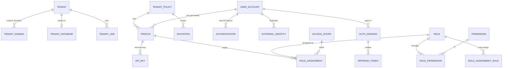
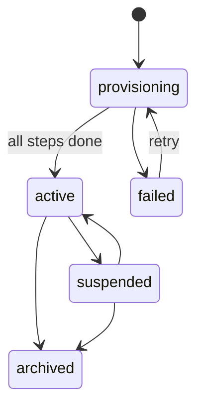

# User, access control and tenancy (v3)

**Status:** specification v3.1, supersedes v2 · **Focus:** tenant provisioning, bootstrapping, tenant resolution and database switching, access control · **Deferred:** financial controls and the approval workflow (section 16) · **Stack:** PHP 8.4, Symfony 8.1, API Platform 5, Doctrine ORM 3 / DBAL 4, PostgreSQL 17–18, PgBouncer 1.21+ · **Rule:** every fact is stated once.

## 1. Scope

One login per person, one profile per society the person belongs to, roles assigned to the profile. Tenancy and IAM live in the landlord database; each society's business data lives in its own database.

| Module | Database and schema | Owns |
| --- | --- | --- |
| Tenancy | Landlord, `tenancy` | Tenant registry and lifecycle, custom domains, tenant database records, tenant jobs, the Tenant Resolver, the tenant connection |
| IAM | Landlord, `iam` | Accounts, profiles, authenticators, sessions, API keys, invitations, permissions, roles, role assignments, audit |
| Business modules | One database per society | Everything a society owns (Multi-tenancy tab) |

Modules talk through events only. IAM never reads `tenancy` tables: what it needs arrives by event (into `iam.tenant_policy`) or from the request's `ResolvedTenant`.

This version covers four things:

1. **Provisioning** a society: tenant record, database, migrations, activation (section 5).
2. **Bootstrapping** the platform and each society's first administrator (section 6).
3. **Resolving** the tenant for every request and **switching the database connection** safely (sections 7 and 8).
4. **Access control**: accounts, profiles, sessions, roles and permissions (sections 9 to 12).

## 2. Decisions

| Topic | Decision |
| --- | --- |
| Isolation | One PostgreSQL database and one login role per society; the landlord database holds only control data |
| Identity | Global `user_account`; one `profile` per (user, tenant); Colsynq staff are profiles in the platform tenant |
| Joining | Self sign-up or join creates the profile automatically under the tenant's join policy; administrators add people by invitation |
| First administrator | Created by a bootstrap invitation sent when the society becomes active; a society can never lose its last administrator |
| Roles | System roles from code, custom roles per tenant; assigned to profiles with optional unit or venture scope |
| Permissions | One catalogue declared in code, synced to a table on deploy |
| Tenant resolution | `kernel.request` priority 20; requirement declared on every route |
| Database switching | One `tenant` connection whose target is chosen at connect time by a DBAL driver middleware; switching only through `TenantScopedRunner` |
| Tokens | Short ES256 JWT without tenant or roles; rotated refresh tokens stored as hashes |
| Decisions | Symfony `unanimous` strategy; assertions for record-level rules |
| Audit | One append-only, partitioned `audit_event` |

## 3. Glossary and naming

| Term | Meaning |
| --- | --- |
| Tenant | A society, or the single platform tenant for Colsynq staff |
| Landlord database | Shared control database (`tenancy`, `iam` schemas) |
| Tenant database | One society's business database |
| User account | A person or service that can authenticate (`user` is reserved in PostgreSQL) |
| Profile | A user's presence in one tenant. Not "member": that word belongs to the Membership module |
| Role assignment | A role given to a profile |
| Assignment rule | Which role holders may assign which roles |
| Access scope | A business unit or venture an assignment can be limited to |
| Tenant context | The tenant the current request, message or command works for |

Naming rules:

- Tables: singular snake\_case, one schema per module, no repeated prefix.
- Foreign keys: `<table>_id`; role-qualified keys get a prefix (`invited_by_profile_id`); `user_id` always means `user_account`.
- Columns: classification `type`, lifecycle `status` (+ `status_reason`, `status_changed_at`), business keys `code`, times `*_at` (timestamptz), booleans `is_*`, secrets `*_hash` or `*_encrypted` + `key_id`.
- Value sets: lower-case text with a CHECK, mapped to PHP backed enums.
- Constraints: PostgreSQL default suffixes `_pkey`, `_fkey`, `_key`, `_check`, `_idx`.
- IDs: UUID v7 generated by the application.
- Rules a foreign key cannot express: constraint triggers named `<table>_<rule>_check`, each with a test.

Code catalogues (not tables): `PermissionProvider`, `SystemRoleCatalogue` (system roles and default assignment rules), `SessionPolicy` (limits per client type).

## 4. Data model

20 landlord tables: 4 in `tenancy`, 16 in `iam` (v2 had 30). Subscriptions, entitlements and support grants are deferred (section 16).



`TENANT` and `TENANT_POLICY` are linked by the same id but live in different modules; there is no foreign key between the schemas.

### 4.1 tenancy

| Table | Columns | Why and key rules |
| --- | --- | --- |
| `tenant` | `id`, `type` (`platform`, `society`; one platform row), `slug` (`^[a-z0-9][a-z0-9-]{1,62}$`, unique while not archived), `legal_name`, `display_name`, `registration_number`, `registering_authority`, `registration_state` (required for societies), `owner_email` (first administrator, cleared once accepted), `status` (`provisioning`, `active`, `suspended`, `archived`, `failed`), `status_reason`, `status_changed_at`, `timezone`, `currency_code`, `logo_url`, `brand_color`, `created_at`, `updated_at` | The registry. `slug` is what `X-Tenant` and subdomains carry; it can change, so nothing else is keyed on it |
| `tenant_domain` | `host` PK, `tenant_id`, `is_primary`, `verification_token_hash`, `verified_at`, `created_at` | Verified custom domains (subdomains come from the slug). Only verified hosts resolve; one primary per tenant |
| `tenant_database` | `tenant_id` PK, `host`, `port`, `database_name` (unique), `login_role` (unique), `secret_ref`, `schema_version`, `schema_status` (`ok`, `migrating`, `failed`, `drift`), `migration_wave` (0–3), `created_at`, `updated_at` | Where a society's database is and how to log in. Names come from the tenant id (`t_<id>`), never the slug. `host` points at PgBouncer. Passwords only as vault references. Separate table so only the connection resolver and job worker are granted it |
| `tenant_job` | `id`, `tenant_id`, `type` (`provision`, `migrate`), `status` (`queued`, `running`, `succeeded`, `failed`, `cancelled`), `step`, `attempt`, `rollout_id`, `details` jsonb, `last_error`, `created_at`, `started_at`, `finished_at` | Long-running tenant work. A partial unique index on `tenant_id` where `status` is `queued` or `running` is the per-tenant lock and stops double submits |

### 4.2 iam: accounts and credentials

| Table | Columns | Why and key rules |
| --- | --- | --- |
| `tenant_policy` | `tenant_id` PK, `is_platform` (one true row), `status` (`active`, `suspended`, `archived`), `join_mode` (`closed`, `open`, `email_domain`), `join_email_domains` text\[\], `mfa_required`, `access_version` bigint, `created_at`, `updated_at` | IAM's own copy of what it needs about a tenant, kept by events. `access_version` keys the access cache and is bumped by any access change in the tenant |
| `user_account` | `id`, `type` (`person`, `service`), `email` (normalised, unique, required for persons), `phone` (E.164, unique once verified), `phone_verified_at`, `given_name`, `family_name`, `password_hash` (persons only), `status` (`active`, `deactivated`), `status_changed_at`, `token_version`, `failed_sign_in_count`, `locked_until`, `created_at`, `updated_at` | The global login and JWT `sub`. A person account exists only after the email is proven, so there is no "verified" column. `token_version` ends every session at once when bumped |
| `authenticator` | `id`, `user_id`, `type` (`totp`, `passkey`, `backup_codes`), `label`, `credential_id` bytea (unique, passkeys), `credential_data` jsonb (passkey public key and sign count, or hashed backup codes), `secret_encrypted` + `key_id` (TOTP seed), `confirmed_at`, `last_used_at`, `revoked_at`, `created_at` | All second factors in one table; one active `backup_codes` row per user; none for service accounts |
| `external_identity` | `id`, `user_id`, `issuer`, `subject` (unique with `issuer`), `email` (display only), `created_at`, `last_used_at` | Google, Microsoft or other OpenID Connect sign-in mapped to an account by issuer and subject, never by email |
| `auth_session` | `id` (`sid`), `user_id`, `client_type` (`member_web`, `member_mobile`, `console`), `authenticated_at`, `auth_methods` text\[\], `assurance_level` (`aal1`, `aal2`), `dpop_jkt`, `ip`, `user_agent`, `created_at`, `last_used_at`, `revoked_at`, `revoke_reason` | One sign-in on one client; records how and when the user authenticated, so a refresh never raises assurance |
| `refresh_token` | `token_hash` PK, `session_id` (cascade), `created_at`, `expires_at`, `used_at` | Single-use rotation; reuse more than 30 s after `used_at` revokes the session |
| `api_key` | `id`, `profile_id` (service account's profile), `name`, `prefix` (unique), `key_hash` (HMAC-SHA-256 with pepper, unique), `pepper_version`, `ip_allow_list` cidr\[\], `expires_at` (≤ 1 year), `last_used_at`, `revoked_at`, `created_at` | Machine access; tenant and authority come from the profile and its assignments |
| `invitation` | `id`, `tenant_id`, `type` (`bootstrap`, `standard`), `email`, `role_id`, `scope_id`, `invited_by_profile_id` (null for bootstrap), `token_hash` (unique), `expires_at`, `accepted_at`, `accepted_user_id`, `revoked_at`, `created_at` | Consent before anyone is added to a society. State is derived from timestamps; one open invitation per (tenant, email) |
| `profile` | `id`, `user_id`, `tenant_id`, `status` (`active`, `disabled`, `removed`), `status_reason`, `status_changed_at`, `metadata` jsonb, `created_at`, `updated_at` | A user's presence in one tenant. Unique (`user_id`, `tenant_id`) and (`id`, `tenant_id`) for composite keys. `metadata` holds whatever a society collects and is never used for access |

### 4.3 iam: access control and audit

| Table | Columns | Why and key rules |
| --- | --- | --- |
| `permission` | `code` PK (`resource:action`), `module`, `name`, `description`, `risk` (`low`, `high`), `allowed_scopes` text\[\], `deprecated_at` | Copy of the code catalogue, synced on deploy, so assignments reference only real permissions. `high` needs recent MFA |
| `role` | `id`, `tenant_id` (null = system role), `code`, `name`, `description`, `scope` (`platform`, `tenant`, `business_unit`, `venture`, `self`), `max_grant_duration` interval, `archived_at`, `created_at`, `updated_at` | Permission bundles. System roles come from code and are read-only. `tenant_id` and `scope` never change. Codes unique per tenant and never reuse a system code |
| `role_permission` | `role_id` + `permission_code` PK | A trigger rejects a permission whose `allowed_scopes` exclude the role's scope |
| `role_assignment` | `id`, `profile_id`, `tenant_id`, `role_id`, `scope_id`, `starts_at`, `expires_at`, `revoked_at`, `created_at` | A profile holding a role, optionally limited to a unit or venture. `tenant_id` is repeated so composite keys keep profile, role and scope in one tenant. One active row per (profile, role, scope) |
| `role_assignment_rule` | `id`, `tenant_id`, `assigner_role_id`, `assignable_role_id`, `effect` (`allow`, `deny`), `created_at` | A tenant's changes to the default rules in code |
| `access_scope` | `tenant_id` + `id` PK, `type` (`business_unit`, `venture`), `name`, `closed_at`, `source_version`, `updated_at` | Local copy of units and ventures, filled from their events, so IAM never queries a tenant database |
| `audit_event` | `occurred_at` + `id` PK, monthly partitions; `tenant_id`, `actor_type` (`user`, `service`, `system`), `actor_user_id`, `session_id`, `action`, `subject_type`, `subject_id`, `payload` jsonb, `correlation_id` | Append-only record of every tenancy and access change, written in the same transaction |

Not stored: password-reset, email-verification and join links (signed URLs bound to `token_version`); the revoked-`sid` list (Redis until tokens expire); tenant passwords (vault).

## 5. Tenant provisioning



### 5.1 Request

`POST /platform/tenants` (permission `tenants:create`, platform tenant only) with slug, names, registration details and `owner_email`. In one landlord transaction Tenancy:

1. checks the slug against reserved words (`www`, `api`, `admin`, `platform`, …) and inserts `tenant` with `status = provisioning`;
2. inserts a `tenant_job` (`type = provision`, `status = queued`);
3. writes `TenantCreatedV1` to the outbox.

The response is `202 Accepted` with the job URL. A repeated request with the same `Idempotency-Key` returns the same job.

### 5.2 Steps

A Messenger worker on the `tenant_provisioning` transport runs the job. Each step checks before acting, so a retry continues where the last attempt stopped. `tenant_job.step` records the last finished step.

| Step | What it does | Idempotency check |
| --- | --- | --- |
| `create_role` | `CREATE ROLE t_<id> LOGIN` with a random 32-byte password saved to the vault first; `ALTER ROLE … SET statement_timeout = '30s'`, `idle_in_transaction_session_timeout = '60s'` | Role exists in `pg_roles`; vault entry exists |
| `create_database` | `CREATE DATABASE t_<id> OWNER t_<id> TEMPLATE template0 ENCODING 'UTF8'`, then `REVOKE CONNECT ON DATABASE t_<id> FROM PUBLIC` and `GRANT CONNECT … TO t_<id>`. Runs outside a transaction (PostgreSQL requires it) | Database exists in `pg_database` |
| `register_database` | Inserts `tenant_database` (host = PgBouncer, `schema_status = migrating`) | Row exists |
| `migrate` | Runs tenant migrations inside `TenantScopedRunner` (section 8.5) | `schema_version` equals the latest |
| `seed` | Reference data only, by version; no users and no money | Seed version recorded |
| `activate` | `status = active`, outbox `TenantActivatedV1` | Status already active |

Rules:

- DDL runs with a separate `provisioner` login that has only `CREATEDB` and `CREATEROLE` (not superuser) and is used only by this worker. The web application cannot create or drop databases.
- Each society's login role can connect only to its own database. A bug in connection switching therefore fails to connect instead of reading another society's data.
- Names are built from the tenant id (`t_` + 32 hex characters = 34, under PostgreSQL's 63-byte limit), so renaming the slug never touches the database.
- On failure: the job and tenant become `failed` with `last_error`; the worker retries 3 times with back-off, then a platform operator can retry (`POST /platform/tenant-jobs/{id}/retry`). The database is dropped only if the tenant never became active.
- Speed-up (optional): keep a migrated `tenant_template` database and use `CREATE DATABASE … TEMPLATE tenant_template`; the template must have no open connections.

### 5.3 Placement

`tenant_database.host` allows more than one PostgreSQL cluster. The job picks the cluster with spare capacity from configuration; moving a tenant later is a separate job type (deferred).

### 5.4 Migrations for all tenants

- `bin/console tenant:migrate --all` creates one `migrate` job per active tenant with a shared `rollout_id`; `--tenant=<slug>` targets one.
- Waves by `migration_wave`: 0 internal, 1 canary, 2 early, 3 everyone. A wave starts only when the previous one succeeded; a failure stops the rollout.
- Each job runs Doctrine Migrations against the tenant connection; the history table lives in each tenant database, and `tenant_database.schema_version` mirrors it for reporting.
- Migrations must be backward compatible (expand, migrate data, contract later), because old and new code run side by side during a rollout.
- A nightly check compares each database's version with the latest and sets `schema_status = drift` if it differs.

### 5.5 Suspension and archiving

- `suspended`: sign-in to that society refused, its API returns 423, jobs paused. Reason required.
- `archived`: read-only for exports. Deleting a society's database is deferred (it needs the retention and legal-hold rules).
- Status changes publish `TenantSuspendedV1`, `TenantReactivatedV1`, `TenantArchivedV1`; IAM copies them into `tenant_policy.status`.

## 6. Bootstrapping

No default passwords, no shared accounts, no administrator created without the person's consent.

### 6.1 Platform (once per installation)

`bin/console iam:bootstrap-platform --email=<first operator>`:

1. creates the `platform` tenant (`tenant` + `tenant_policy` with `is_platform = true`) if missing;
2. runs `iam:sync-catalogue` (permissions and system roles from code);
3. creates a `bootstrap` invitation for `platform_admin` and prints nothing secret (the link is emailed);
4. refuses to run again once the platform has an active `platform_admin`.

It needs shell access to production, is written to `audit_event` with `actor_type = system`, and is the only way to create the first platform administrator.

### 6.2 Each society

1. IAM handles `TenantCreatedV1`: creates `tenant_policy` (`join_mode = closed`, `status = provisioning`).
2. IAM handles `TenantActivatedV1`: creates a `bootstrap` invitation for the owner email with the `society_admin` system role and tenant scope, valid 7 days, and publishes `InvitationCreatedV1` for the email sender.
3. The owner opens the link, signs up or signs in (email proven either way), and accepts. In one transaction IAM creates the profile, the `society_admin` assignment and an `audit_event`, then publishes `ProfileCreatedV1` and `RoleAssignedV1`. Tenancy clears `tenant.owner_email` on `ProfileCreatedV1` for a bootstrap invitation.
4. The owner sets the join mode and invites other staff.

Rules:

- A platform operator can resend or replace the owner invitation (`POST /platform/tenants/{id}/owner-invitation`) only while the society has no active `society_admin`.
- Last-administrator guard: disabling, removing or revoking the last active `society_admin` assignment is refused.
- Platform staff get no role inside a society by bootstrapping it; support access is deferred.

## 7. Tenant resolution

`TenantResolveListener` runs on `kernel.request` at priority 20: after the router (32), so the route's requirement is known, and before the firewall (8), so authentication can check the profile in that tenant.

### 7.1 Route requirement

Every route declares `#[TenantRequirement]`; the router compiles it into the `_tenant` route default. A route without it fails the architecture test.

| Requirement | Used by | Behaviour |
| --- | --- | --- |
| `Required` | Society APIs | Tenant must resolve and be `active`; otherwise 400, 404 or 423 |
| `Optional` | Sign-up, sign-in, invitation pages, branding | Tenant used when present |
| `None` | Account endpoints (`/me`, sessions, authenticators) | Tenant hints ignored |
| `Platform` | `/platform/*` | Platform tenant only; no tenant database |

### 7.2 Where the tenant comes from

1. `X-Tenant: <slug>` header (mobile and API clients, and the web app on the shared host).
2. Host: `<slug>.colsynq.app`, or a verified `tenant_domain.host`.

If both are present and disagree, the request fails with 400. Header and host values are normalised (lower case, no port) before lookup.

### 7.3 Lookup and caching

`TenantDirectory` reads `tenant` and `tenant_domain` from the landlord database and caches the result for 60 s in APCu or Redis under `tenant:slug:<slug>` and `tenant:host:<host>`, including misses (to absorb random-slug scans). Status changes and slug or domain changes delete the cache entries at once.

The result is an immutable `ResolvedTenant` (id, slug, type, status, display name, branding). It never holds connection details.

### 7.4 Tenant context

- `TenantContext` holds the current `ResolvedTenant` for the request, message or command. It is set once (`TenantAlreadySet` if set twice) and implements Symfony `ResetInterface`, so the kernel clears it between requests in long-running servers (FrankenPHP worker mode, RoadRunner) and between Messenger messages.
- After authentication, a `Required` route also needs an `active` profile in that tenant. Without one the answer is 403 with no hint that the tenant exists.
- The tenant is never taken from the JWT, the request body or a query parameter.

## 8. Database connection switching

### 8.1 Connections and entity managers

| Connection | Entity manager | Target | Mapped modules |
| --- | --- | --- | --- |
| `landlord` | `landlord` (default) | Fixed landlord database | Tenancy, IAM, Integrations |
| `tenant` | `tenant` | Chosen at connect time from `TenantContext` | All business modules |

One `tenant` connection serves every society; there is no connection per tenant in configuration. Its configured URL is a placeholder that is always replaced.

```yaml
doctrine:
  dbal:
    default_connection: landlord
    connections:
      landlord:
        url: '%env(LANDLORD_DATABASE_URL)%'
      tenant:
        url: '%env(TENANT_DATABASE_URL)%' # placeholder; replaced by the middleware
  orm:
    default_entity_manager: landlord
    entity_managers:
      landlord: { connection: landlord, mappings: { Tenancy: ~, Iam: ~ } }
      tenant:   { connection: tenant,   mappings: { Ledger: ~, Payments: ~ } }
```

### 8.2 Choosing the database at connect time

DBAL opens a connection lazily, on the first query. A driver middleware on the `tenant` connection swaps in the current society's host, database and credentials at that moment:

```php
#[AsMiddleware(connections: ['tenant'])]
final readonly class TenantConnectionMiddleware implements Middleware
{
    public function __construct(private TenantConnectionResolver $resolver) {}

    public function wrap(Driver $driver): Driver
    {
        return new TenantDriver($driver, $this->resolver);
    }
}

final class TenantDriver extends AbstractDriverMiddleware
{
    public function __construct(Driver $driver, private readonly TenantConnectionResolver $resolver)
    {
        parent::__construct($driver);
    }

    public function connect(#[\SensitiveParameter] array $params): DriverConnection
    {
        $target = $this->resolver->forCurrentTenant(); // throws TenantNotResolved

        return new TenantBoundConnection(
            parent::connect([...$params,
                'host' => $target->host,
                'port' => $target->port,
                'dbname' => $target->databaseName,
                'user' => $target->loginRole,
                'password' => $target->password,
            ]),
            $target->tenantId,
            $this->resolver,
        );
    }
}
```

- `TenantConnectionResolver` reads `tenant_database` (landlord) and the password from the vault by `secret_ref`. It keeps them in process memory for up to 10 minutes and never writes passwords to a shared cache.
- No tenant in context means `TenantNotResolved`: the query never runs (fail closed).
- `TenantBoundConnection` remembers which tenant it was opened for and, before every query, compares it with `TenantContext`. On a mismatch it throws `TenantConnectionMismatch` instead of running the query. This catches any missed switch.
- A `Platform` route has no tenant database; using the `tenant` entity manager there is an error.

### 8.3 Switching

Inside an HTTP request the tenant never changes. Everything else (workers, commands, jobs) switches only through `TenantScopedRunner`:

```php
$runner->run($tenantId, function (): void {
    // tenant entity manager and connection point at this society here
});
```

The runner:

1. refuses to start inside another run or while the tenant connection has an open transaction;
2. sets `TenantContext`;
3. calls the callback;
4. in `finally`: rolls back any open transaction, clears the `tenant` entity manager (no entities leak between societies), closes the `tenant` connection, resets an entity manager that was closed by an exception, and restores the previous context.

Closing the connection makes the next tenant's first query reconnect through the middleware with the right credentials.

### 8.4 Messages and background work

- Every message for tenant work carries a `TenantStamp` (tenant id), added by a dispatch middleware from the current `TenantContext`. Dispatching tenant work without a context fails.
- A worker middleware reads the stamp and runs the handler inside `TenantScopedRunner`. A tenant message without a stamp is rejected to the failure transport.
- Scheduled jobs that cover all societies loop over active tenants and call the runner once per tenant; one failure is logged and does not stop the others.
- Outbox relays read each tenant database's outbox inside the runner.

### 8.5 Migrations and console

- `tenant:migrate` uses Doctrine Migrations with the `tenant` entity manager, inside the runner, one tenant at a time (or in parallel processes, one tenant per process).
- Every tenant console command takes `--tenant=<slug>` (or `--all`) and runs inside the runner; without it, the command refuses to touch the tenant connection.

### 8.6 Caches and other shared state

- Every cache key for tenant data starts with `t:<tenant_id>:`; Doctrine result and second-level cache regions use a tenant-specific namespace.
- Locks, rate limits and Redis streams follow the same prefix rule.
- Files go under `tenants/<tenant_id>/` in object storage.

### 8.7 Connection pooling

PostgreSQL processes are expensive, and many tenant databases multiply connections. PgBouncer sits between the application and every cluster:

- Transaction pooling; pools are per (database, login role), so each society gets its own small pool (`default_pool_size` 5, `max_db_connections` per society, `server_idle_timeout` closes pools of idle societies).
- PgBouncer 1.21 or later with `max_prepared_statements` above zero, because `pdo_pgsql` uses protocol-level prepared statements; alternatively enable emulated prepares on the tenant connection.
- No session state in tenant code: no plain `SET`, session advisory locks, `LISTEN` or holdable cursors. Use `SET LOCAL` and transaction-level advisory locks. Per-society timeouts are set on the login role (5.2), which works with pooling.
- PgBouncer looks up passwords with `auth_query` against a restricted function, so adding a society needs no PgBouncer restart.

### 8.8 Credential rotation

A rotation job sets a new password on the login role, writes it to the vault and bumps the vault version. Workers holding the old password get an authentication error on their next new connection; the resolver then re-reads the vault once and retries.

## 9. Identity and profiles

### 9.1 Sign-up and joining

1. `POST /auth/sign-up` on a society's host or with `X-Tenant` (`Optional` route).
2. The email is proven by a signed link or code before anything is stored. Then `RegisterUserInTenant` runs in one landlord transaction:
   - create `user_account` if the email is new; if it exists, the person must sign in first (no takeover by sign-up);
   - create the profile if `join_mode` allows it (`open`, or `email_domain` with a matching domain); `closed` needs an invitation;
   - assign the `member` system role with scope `self`;
   - publish `UserRegisteredV1` and `ProfileCreatedV1`.
3. Idempotent: an `active` profile is returned; a `removed` one is reactivated; a `disabled` one is refused.
4. A signed-in user joins another society with `POST /me/profiles` (same rules) or by accepting an invitation.

### 9.2 One user in several societies

- `GET /me/profiles` lists active profiles with each society's name, slug and logo.
- Switching society means sending another `X-Tenant`; tokens are not reissued, because the JWT names the user and session, not the tenant.
- Custom domains receive a one-time handoff code (60 s, single use, bound to the session), so a session cookie never crosses domains.
- Every request checks the profile in the requested tenant and that tenant's `mfa_required`; a society that requires MFA asks for it only when that society is used.
- Roles, status and metadata never cross societies; administrators see only profiles in their own tenant.

### 9.3 User management

| Action | Permission | Effect |
| --- | --- | --- |
| Invite | `profiles:invite` | `invitation`; email with a signed link; accepting creates the profile and assignment |
| Disable profile | `profiles:disable` | `status = disabled`, `access_version` + 1; access to that society stops at once |
| Remove profile | `profiles:remove`, or the user | `status = removed`, assignments revoked, records kept |
| Deactivate account | User, or platform `accounts:deactivate` | All sessions revoked, all profiles disabled |
| Lockout | Automatic | 5 failed sign-ins → 15 minutes, doubling; `locked_until` |

Service accounts (`type = service`) are created by a society administrator for integrations, have exactly one profile, no password or second factor, and authenticate with `api_key` only.

### 9.4 External sign-in

OpenID Connect authorization code flow with PKCE, `state` and `nonce`, bound to the browser by the `__Host-oauth_tx` cookie, with one central callback. Accounts are matched on (`issuer`, `subject`). An unknown identity whose email already has an account must sign in and link it; it is never linked automatically. External sign-in counts as one factor.

## 10. Sessions and tokens

| Item | Value |
| --- | --- |
| Access token | JWT, ES256, 10 min; claims `sub`, `sid`, `ver` (`token_version`), `amr`, `acr`, `auth_time`, `cnf` for DPoP; no tenant or roles |
| Refresh token | Opaque 256-bit value stored as a SHA-256 hash; rotated on each use; 30 s grace; reuse after grace revokes the session |
| Web | Backend-for-frontend: tokens stay on the server; the browser holds a `__Host-` cookie (Secure, HttpOnly, SameSite=Lax) and a CSRF token |
| Mobile | DPoP-bound tokens (`dpop_jkt`) |
| Limits | `SessionPolicy`: idle 30 min (console 15), maximum age 12 h (mobile 30 days) |
| Revocation | `POST /auth/revoke`, sign-out, "sign out everywhere" (`token_version` + 1), `GET/DELETE /me/sessions` |

| Operation | Tables |
| --- | --- |
| Sign-in | `user_account` (lockout), `authenticator`, `auth_session` insert, `refresh_token` insert, `audit_event` |
| Refresh | `refresh_token` (mark used, insert next), `auth_session.last_used_at` |
| Step-up | `authenticator`; `auth_session` (`auth_methods`, `assurance_level`, `authenticated_at`) |
| Sign-out | `auth_session.revoked_at`, `refresh_token` (cascade), Redis `sid` list |
| Password change | `user_account.password_hash`, `token_version` + 1 |

Each request checks the JWT signature and expiry, then `sid` against the revoked list and `ver` against `token_version` (cached 60 s).

## 11. Access control

### 11.1 Model

A profile holds role assignments; a role holds permissions; an assignment can be limited to one unit or venture.

| Scope | Meaning |
| --- | --- |
| `platform` | Colsynq staff, platform tenant only |
| `tenant` | Whole society |
| `business_unit`, `venture` | One unit or venture (`scope_id`) |
| `self` | The user's own records |

Effective access = the union of permissions from active assignments, each with its scope. It is cached under (`profile_id`, `access_version`); any role, permission or assignment change in the tenant bumps `access_version`, so stale access disappears at once.

### 11.2 Voters and assertions

One `PermissionVoter` asks `AccessEvaluator` and then the assertions registered for that permission. Each returns `Grant`, `Deny`, `Abstain` or `Challenge`. Strategy `unanimous`: any `Deny` refuses, any `Challenge` returns 401 with `insufficient_user_authentication`, otherwise one `Grant` is needed.

| Assertion | Rule |
| --- | --- |
| `HasPermission` | Permission held with a scope that covers the record |
| `ProfileIsActive` | Profile `active` in the current tenant |
| `TenantIsActive` | Writes refused unless the tenant is `active` |
| `RecentAuthentication` | `high` permissions need AAL2 within 15 minutes |
| `ResourceInScope` | The record's unit or venture matches the assignment |

New rules (from the approval module later, for example) are added as assertions; nothing else changes.

### 11.3 Assigning roles

Checked in order:

1. a tenant `deny` rule for (assigner role, assignable role) refuses;
2. permission `role-assignments:assign-any` allows;
3. a tenant `allow` rule allows;
4. the default in code allows (for example `society_admin` may assign any tenant role).

Always: nobody assigns a role to themselves; nobody grants a permission they do not hold; the scope must lie inside the assigner's own scope; `max_grant_duration` caps `expires_at`; the last `society_admin` cannot be removed.

### 11.4 Catalogue sync

`iam:sync-catalogue` runs on every deploy: it upserts `permission` from `PermissionProvider` and system roles with their permissions from `SystemRoleCatalogue`, marks removed permissions `deprecated_at`, and fails the deploy if a custom role still uses a deprecated permission.

## 12. Request pipeline

| Step | Component | Fails with |
| --- | --- | --- |
| 1 | Router (priority 32) | 404 |
| 2 | Tenant resolver (20): requirement, lookup, `TenantContext` | 400 conflicting hints, 404 unknown, 423 suspended |
| 3 | Firewall (8): JWT or API key, `sid`, `ver`, DPoP | 401 |
| 4 | Profile in tenant, `SessionPolicy`, tenant MFA rule | 403, 401 |
| 5 | Voter and assertions | 403, or 401 step-up |
| 6 | Handler; first tenant query connects through the middleware | 500 `TenantNotResolved` (fail closed) |
| 7 | Outbox events and `audit_event` in the same transaction |  |
| 8 | `kernel.terminate` / reset: context cleared, entity managers cleared |  |

## 13. Audit

- Every change to tenants, tenant jobs, accounts, profiles, invitations, roles, assignments, sessions and API keys writes `audit_event` in the same transaction as the change.
- The application role may only insert into `audit_event`; updates and deletes are revoked.
- Partitions are monthly; old partitions are detached and archived, never edited.

## 14. API endpoints and events

| Area | Endpoints |
| --- | --- |
| Auth | `POST /auth/sign-up`, `/auth/sign-in`, `/auth/refresh`, `/auth/revoke`, `/auth/step-up`, `/auth/password/reset`; `GET /auth/oauth/{issuer}/start`, `/auth/oauth/callback` |
| Me | `GET /me`; `GET/POST /me/profiles`; `GET/DELETE /me/sessions`; `GET/POST/DELETE /me/authenticators`; `GET/DELETE /me/external-identities` |
| Society administration | `/profiles`, `/invitations`, `/roles`, `/role-assignments`, `/role-assignment-rules`, `/service-accounts`, `/api-keys`, `GET /audit-events` |
| Platform | `/platform/tenants` (+ `/suspend`, `/reactivate`, `/archive`, `/owner-invitation`, `/domains`), `/platform/tenant-jobs` (+ `/retry`), `/platform/rollouts` |

| Module | Publishes |
| --- | --- |
| Tenancy | `TenantCreatedV1`, `TenantActivatedV1`, `TenantSuspendedV1`, `TenantReactivatedV1`, `TenantArchivedV1`, `TenantProvisioningFailedV1` |
| IAM | `UserRegisteredV1`, `ProfileCreatedV1`, `ProfileDisabledV1`, `ProfileRemovedV1`, `RoleAssignedV1`, `RoleAssignmentRevokedV1`, `InvitationCreatedV1`, `AccountDeactivatedV1` |

IAM consumes the Tenancy events and the business-unit and venture events (for `access_scope`). Tenancy consumes `ProfileCreatedV1` only to clear `owner_email`.

## 15. Tests and go-live checklist

Architecture tests:

- IAM and Tenancy import nothing from each other or from business modules.
- Every route has `#[TenantRequirement]`; every write route has a voter.
- Business-module entities are mapped only to the `tenant` entity manager; Tenancy and IAM only to `landlord`.

Tenancy and switching tests:

- A query on the `tenant` connection without a context throws `TenantNotResolved`.
- `TenantScopedRunner` over societies A then B: B sees none of A's entities, and the second connection is opened with B's credentials.
- Changing the context without the runner makes the next query throw `TenantConnectionMismatch`.
- Society A's login role cannot connect to society B's database.
- Provisioning killed after each step resumes and finishes; a second job for the same tenant is refused.
- A Messenger message without a `TenantStamp` goes to the failure transport.

Access tests:

- A profile in society A gets 403 on every society B route.
- Self-assignment, granting a permission you lack, out-of-scope assignment and removing the last `society_admin` are refused.
- Refresh-token reuse revokes the session; a `token_version` change ends all sessions.

Go-live checklist:

- [ ] Platform bootstrapped with `iam:bootstrap-platform`
- [ ] `provisioner` login limited to `CREATEDB` and `CREATEROLE`, used only by the job worker
- [ ] PgBouncer ≥ 1.21 with `max_prepared_statements` set and `auth_query` in place
- [ ] Migration rollout rehearsed on copies of tenant databases
- [ ] JWT signing keys and tenant passwords in the vault; rotation tested
- [ ] Backups restore a single society's database

## 16. Deferred

| Item | Why deferred | Where it plugs in |
| --- | --- | --- |
| Financial controls: dual control, transaction signing, device binding, new-device limits, delayed activation of financial roles, dormancy | Belongs with Payments | New assertions; a `financial` permission risk level |
| Approval workflow: second approver for bootstrap and support access, `NotSelf`, separation of duties | Dedicated approval module | Assertions and events |
| Support access and break-glass for Colsynq staff | Needs approvals | `support_access_grant`, token exchange |
| KYB (business verification of societies) | Gates financial features only | Tenancy status column and an assertion |
| Plans, subscriptions and feature flags | Billing module | `FeatureIsEnabled` assertion |
| Integrations and bank webhooks (`Webhook` tenant requirement) | Integrations tab | Resolver requirement, `TenantScopedRunner` |
| Moving a tenant between clusters; deleting a tenant database | Needs retention and legal-hold rules | New `tenant_job` types |
| Membership | Separate design | Events from IAM |

## 17. Change history

| Version | Change |
| --- | --- |
| v1 | First design (review history) |
| v2 | Profile pattern; DBA and security reviews |
| v3 | Lean rewrite: clear names, every rule stated once |
| v3.1 | Focus on provisioning, bootstrapping, resolution and connection switching, access control; financial controls, approvals, support access, KYB and plans deferred. 30 → 20 tables |

Renames from v2:

| v2 | v3 |
| --- | --- |
| `app_user` | `user_account` |
| `user_profile` | `profile` |
| `user_role` | `role_assignment` |
| `user_role_assign_role` | `role_assignment_rule` |
| `scope_reference`, `scope_ref_id` | `access_scope`, `scope_id` |
| `user_authenticator`, `public_data` | `authenticator`, `credential_data` |
| `permission.slug` | `permission.code` |
| `kind` columns | `type` |
| `amr`, `acr`, `auth_time` columns | `auth_methods`, `assurance_level`, `authenticated_at` (JWT claims keep their standard names) |
| `lookup_hash` | `key_hash` |
| `external_identity.provider` | `issuer` |
| `signup_mode` | `tenant_policy.join_mode` |
| `platform_tenant` | `tenant_policy.is_platform` |
| `user_profile.access_version` | `tenant_policy.access_version` |
| `can_assign_all` | permission `role-assignments:assign-any` |
| `one_time_token` | Signed links and `invitation` |
| `UserRoleGrantedV1`, `TenantProvisionedV1` | `RoleAssignedV1`, `TenantActivatedV1` |

Open item: replacing the gesdinet refresh-token bundle with the `refresh_token` table is a dependency change and needs approval; until then gesdinet runs with hashing, rotation and reuse detection on.
