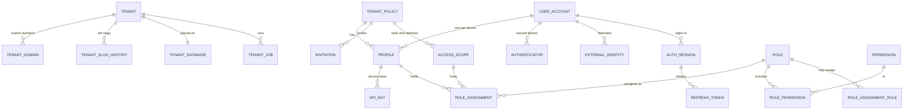
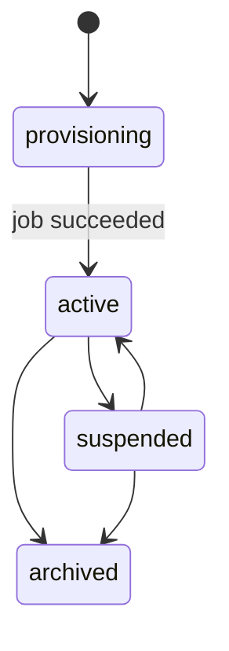
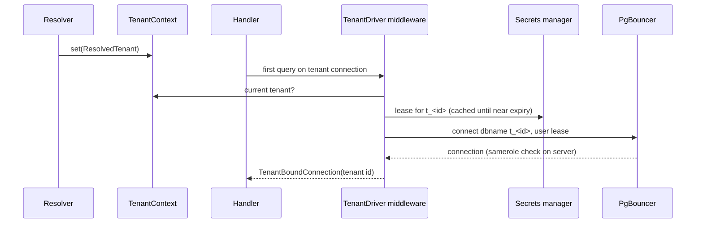

# User, access control and tenancy (v4)

**Status:** specification v4, supersedes v3.1 and v2 · **Focus:** tenant provisioning, bootstrapping, tenant resolution (subdomain, custom domain, header) and database connection switching, access control · **Deferred:** financial controls, approval workflow, support access, KYB, plans (section 17) · **Stack:** PHP 8.4, Symfony 8.1, API Platform 5, Doctrine ORM 3 / DBAL 4, PostgreSQL 17–18, PgBouncer (latest patched), FrankenPHP/Caddy, Redis · **Reviews behind this version:** `doc/research_notes/data_model/v4_data_model_review.md`, `v4_domain_resolution_research.md`, `v4_security_redundancy_review.md`.

## 1. Scope and ownership

One login per person, one profile per society, roles on the profile. Tenancy, IAM, audit and messaging tables live in the landlord database; each society's business data lives in its own database.

| Module | Landlord schema | Owns |
| --- | --- | --- |
| Tenancy | `tenancy` | Tenant registry and lifecycle, domains, slugs, database placement, tenant jobs, the Tenant Resolver, the tenant connection |
| IAM | `iam` | Accounts, credentials, sessions, profiles, invitations, permissions, roles, assignments |
| Shared infrastructure | `audit`, `messaging` | Audit trail; outbox and inbox for every landlord module |
| Business modules | One database per society | Everything a society owns |

Modules exchange events only. IAM never reads `tenancy` tables; what it needs arrives by event or from the request's `ResolvedTenant`.

### 1.1 Single source of truth

The reviews found the same topics described in three or four tabs, often differently. From v4 each topic has one owner; other tabs link to it.

| Topic | Owner |
| --- | --- |
| Module and event rules, logging and PII rules | Architecture guide |
| Landlord data model, tenant lifecycle, bootstrapping, tenant resolution, connection switching, PostgreSQL roles per tenant, access control, session limits, audit | **This tab** |
| Credential mechanics: password hashing, JWT keys and rotation, BFF and DPoP, MFA and passkeys, OAuth client, API key format, rate-limit values | Authentication tab (to be rewritten with v4 names) |
| Fleet operations: PgBouncer and cluster runbooks, backup and restore, capacity | Multi-tenancy tab (to be reduced to operations) |
| Secrets manager, data residency, retention, incident response, compliance mapping | Security and compliance tab (new, to be written) |

v1, v2 and v3 stay only as history and are marked superseded.

## 2. Decisions

| Topic | Decision |
| --- | --- |
| Isolation | One database per society. Per society: a non-login owner role, a migrator role and a runtime role; runtime may only read and write rows |
| Network rule | `pg_hba.conf` uses `samerole`: a login can connect only to the database whose name is its group role (`t_<id>`). Wrong switching fails to connect |
| Credentials | Short-lived database logins issued by the secrets manager (database secrets engine); no static tenant passwords |
| Identity | Global `user_account`; one `profile` per (user, tenant); staff are profiles in the platform tenant |
| Joining | Self sign-up or join creates the profile under the tenant's join policy; administrators add people by invitation |
| First administrator | Bootstrap invitation created with the tenant, sent on activation, MFA required on acceptance |
| Tenant addressing | `<slug>.colsynq.app`, verified custom domains, or `X-Tenant` on shared hosts |
| Sign-in location | All credential steps on `auth.colsynq.app`; custom domains receive a one-time handoff code |
| Tokens | ES256 JWT with `kid`, 10 min; refresh tokens rotated, no grace window |
| Access | Roles with scopes; Symfony `unanimous` strategy with assertions |
| Landlord isolation | Composite tenant keys, a Doctrine tenant filter and cross-tenant tests; PostgreSQL row-level security is planned hardening (section 16.3) |
| Audit | `audit.event`, append-only, partitioned, security outcomes included, daily signed digest to WORM storage |

## 3. Naming

- Tables singular snake\_case, one schema per module, no repeated prefix (`audit.event`, not `audit.audit_event`).
- Keys: `id` (UUID v7 from the application); foreign keys `<table>_id`; role-qualified keys prefixed (`invited_by_profile_id`); `user_id` always means `user_account`.
- Columns: `type` for classification, `status` (+ `status_reason`, `status_changed_at`) for lifecycle, `code` for business keys, `*_at` timestamptz, `is_*` booleans, `*_hash` or `*_encrypted` + `key_id` for secrets, `*_level` for ordered values, `*_days` for durations.
- Value sets: lower-case text with CHECK, mapped to PHP backed enums. Lists: `jsonb` arrays (DBAL 4 has no PostgreSQL array type).
- Constraints named `<table>_<purpose>_<suffix>` with `_pkey`, `_fkey`, `_key`, `_check`, `_idx`; triggers `<table>_<rule>_check`, each with a test.
- The word "member" is reserved for the Membership module; IAM uses "profile" and the default role is `self_service`.

## 4. Data model

23 landlord tables: `tenancy` 5, `iam` 15, `audit` 1, `messaging` 2. Database names, role names and secret paths are derived from the tenant id, so they are not stored.



`tenant` and `tenant_policy` share the tenant id but belong to different modules, so there is no foreign key between them; `tenant_policy` is the parent of every tenant-bound `iam` row.

### 4.1 tenancy

| Table | Columns | Why and key rules |
| --- | --- | --- |
| `tenant` | `id`, `type` (`platform`, `society`), `slug`, `legal_name`, `display_name`, `registration_number`, `registering_authority`, `registration_state`, `status` (`provisioning`, `active`, `suspended`, `archived`), `status_reason`, `status_changed_at`, `timezone`, `currency_code`, `logo_url`, `brand_color`, `version`, `created_at`, `updated_at` | The registry. One `platform` row (partial unique). Unique slug for life. Societies must have registration fields (CHECK); unique (`registering_authority`, `registration_number`) stops double registration. Provisioning failure lives on the job, not here. `version` for optimistic locking |
| `tenant_domain` | `id`, `tenant_id`, `host` (lower-case ASCII, punycode), `status` (`pending`, `active`, `failing`, `inactive`, `removed`), `verification_token`, `is_primary`, `verified_at`, `last_checked_at`, `check_failures`, `cert_status` (`none`, `issued`, `failed`), `cert_expires_at`, `last_error`, `created_at`, `removed_at` | Custom domains with a real lifecycle. `host` unique while not removed and only once verified, so an unverified claim cannot block the owner. One primary per tenant, and it must be active. The token is public in DNS, so it is stored plain |
| `tenant_slug_history` | `slug` PK, `tenant_id`, `retired_at`, `redirect_until` | Old slugs redirect for 90 days and are never given to another society, so old links and QR codes cannot be hijacked |
| `tenant_database` | `tenant_id` PK, `cluster_code`, `schema_version`, `migrated_at`, `migration_wave` (0–3), `created_at`, `updated_at` | Placement only. `cluster_code` names a cluster in configuration, which holds its pooled and direct endpoints. Database `t_<id>`, roles `t_<id>`, `t_<id>_owner`, `t_<id>_migrator` and secret paths are derived |
| `tenant_job` | `id`, `tenant_id`, `type` (`provision`, `migrate`), `status` (`queued`, `running`, `succeeded`, `failed`, `cancelled`), `step`, `attempt`, `rollout_id`, `details` jsonb, `last_error`, `heartbeat_at`, `created_at`, `started_at`, `finished_at` | Long-running work. Partial unique index on `tenant_id` where queued or running is the lock; a reaper fails jobs whose `heartbeat_at` is older than 5 minutes so a crashed worker cannot block a society |

### 4.2 iam: accounts and credentials

| Table | Columns | Why and key rules |
| --- | --- | --- |
| `tenant_policy` | `tenant_id` PK, `is_platform`, `status` (`provisioning`, `active`, `suspended`, `archived`), `join_mode` (`closed`, `open`, `email_domain`), `join_email_domains` jsonb, `mfa_required`, `access_version`, `source_version`, `created_at`, `updated_at` | IAM's copy of the tenant, kept by events; an event applies only if its version is newer. `access_version` keys the access cache |
| `user_account` | `id`, `type` (`person`, `service`), `email` (lower case), `phone` (E.164), `phone_verified_at`, `given_name`, `family_name`, `password_hash`, `status` (`active`, `deactivated`), `status_reason`, `status_changed_at`, `token_version`, `created_at`, `updated_at` | Global login and JWT `sub`. CHECKs: persons have an email; service accounts have no email or password. Email unique; phone unique once verified. Sign-in throttling lives in Redis (10.4), not in columns |
| `authenticator` | `id`, `user_id`, `type` (`totp`, `passkey`, `backup_codes`), `label`, `credential_id` bytea, `credential_data` jsonb, `secret_encrypted`, `key_id`, `confirmed_at`, `last_used_at`, `revoked_at`, `created_at` | Second factors. CHECKs per type (passkey has `credential_id`; TOTP has a secret). One active backup-code set per user. Rows are locked when a code is used or a sign count changes |
| `external_identity` | `id`, `user_id`, `issuer`, `subject`, `email`, `created_at`, `last_used_at` | OpenID Connect links; unique (`issuer`, `subject`) |
| `auth_session` | `id` (`sid`), `user_id`, `client_type` (`web`, `mobile`, `console`), `authenticated_at`, `auth_methods` jsonb, `assurance_level` (`aal1`, `aal2`, `aal3`), `dpop_jkt`, `ip`, `user_agent`, `created_at`, `last_used_at`, `revoked_at`, `revoked_reason` | One sign-in on one client; source of truth for revocation |
| `refresh_token` | `token_hash` PK, `session_id`, `created_at`, `expires_at`, `used_at` | Single use. Indexes on `session_id` and `expires_at` |
| `api_key` | `id`, `profile_id`, `name`, `key_prefix`, `key_hash` (unique), `pepper_version`, `ip_allow_list` jsonb, `expires_at`, `last_used_at`, `revoked_at`, `created_at` | Machine access. Looked up by `key_hash`; `key_prefix` is for display. Trigger: the profile belongs to a service account |
| `invitation` | `id`, `tenant_id`, `type` (`bootstrap`, `standard`), `email`, `role_id`, `scope_id`, `invited_by_profile_id`, `token_hash`, `sent_at`, `expires_at`, `accepted_at`, `accepted_user_id`, `revoked_at`, `created_at` | Consent. CHECKs: bootstrap ⇔ no inviter; `accepted_at` ⇔ `accepted_user_id`. One open invitation per (tenant, email); re-inviting revokes the old row in the same transaction |
| `profile` | `id`, `user_id`, `tenant_id`, `status` (`active`, `disabled`, `left`, `removed`), `status_reason`, `status_changed_at`, `metadata` jsonb, `created_at`, `updated_at` | A user in one tenant. Unique (`user_id`, `tenant_id`) and (`id`, `tenant_id`). `left` = the user left and may rejoin; `removed` = an administrator removed them and only an invitation brings them back. `metadata` is free-form society data, never used for access and never holding identity documents. Trigger: a service account has exactly one profile |

### 4.3 iam: access control

| Table | Columns | Why and key rules |
| --- | --- | --- |
| `permission` | `code` PK, `module`, `name`, `description`, `risk_level` (`low`, `high`), `allowed_scope_types` jsonb, `deprecated_at` | Copy of `PermissionProvider`, synced on deploy |
| `role` | `id`, `tenant_id` (null = system), `code`, `name`, `description`, `scope_type` (`platform`, `tenant`, `business_unit`, `venture`, `self`), `max_grant_days`, `archived_at`, `created_at`, `updated_at` | Unique code per tenant, and custom codes never reuse a system code. CHECK: `platform` roles are system roles. `tenant_id` and `scope_type` never change |
| `role_permission` | `role_id` + `permission_code` PK | Trigger: the permission allows the role's scope type |
| `role_assignment` | `id`, `profile_id`, `tenant_id`, `role_id`, `scope_id`, `expires_at`, `revoked_at`, `created_at` | Unique (`profile_id`, `role_id`, `scope_id`) NULLS NOT DISTINCT where `revoked_at` is null. Triggers: the role is a system role or this tenant's (`role_assignment_role_tenant_check`); `scope_id` is null exactly when the scope type is `tenant` or `self`, and otherwise matches the scope's type (`role_assignment_scope_check`). A sweeper revokes expired rows |
| `role_assignment_rule` | PK (`tenant_id`, `assigner_role_id`, `assignable_role_id`), `effect` (`allow`, `deny`), `created_at` | A tenant's changes to the default rules in code |
| `access_scope` | `id`, `tenant_id`, `type` (`business_unit`, `venture`), `name`, `closed_at`, `source_version`, `updated_at` | Copy of units and ventures from events; unique (`id`, `tenant_id`). Closing a scope revokes its assignments and bumps `access_version` in one transaction |

### 4.4 audit and messaging

| Table | Columns | Why and key rules |
| --- | --- | --- |
| `audit.event` | PK (`occurred_at`, `id`), monthly partitions plus a DEFAULT partition; `tenant_id`, `actor_type` (`person`, `service`, `system`), `actor_user_id`, `session_id`, `ip`, `action`, `outcome` (`success`, `failure`, `denied`), `subject_type`, `subject_id`, `payload` jsonb, `correlation_id` | Every tenancy and access change, and every security event (failed sign-in, denied access, cross-tenant attempt). Insert-only for the application role. Indexes (`tenant_id`, `occurred_at`) and (`subject_type`, `subject_id`). Written with DBAL and excluded from Doctrine schema diffs |
| `messaging.outbox` | `id`, `source_module`, `event_type`, `event_version`, `aggregate_id`, `tenant_id`, `payload` jsonb, `occurred_at`, `published_at` | Events written in the same transaction as the change; a relay publishes them. Index on unpublished rows |
| `messaging.inbox` | PK (`consumer`, `event_id`), `received_at` | Each consumer handles an event once, even when it is delivered twice |

### 4.5 Relationship rules and Doctrine mapping

- Tenant-bound `iam` rows reference `tenant_policy(tenant_id)` and use composite foreign keys (`profile_id`, `tenant_id`) → `profile(id, tenant_id)` and (`scope_id`, `tenant_id`) → `access_scope(id, tenant_id)`, so a row can never point into another tenant.
- References to `role` are plain foreign keys plus the role-tenant trigger, because system roles have no tenant and a composite key could never match them.
- Doctrine cannot map a join to a non-primary key, so entities map a single-id association plus a plain `tenant_id` field. Composite keys, NULLS NOT DISTINCT indexes, partial indexes and triggers live in hand-written migrations, are excluded from schema diffs, and are checked by a test that queries the catalogue.
- No association crosses entity managers or modules; such references are ids only.
- DBAL types: `jsonb` for lists, small in-house types for `inet`; durations as integer days.

### 4.6 Hot-path indexes

| Path | Index |
| --- | --- |
| Resolve by slug | unique `tenant.slug`; `tenant_slug_history` PK |
| Resolve by host | unique `tenant_domain(host)` where `status in ('active','failing')` |
| Profile check | unique `profile(user_id, tenant_id)` INCLUDE (`id`, `status`) |
| Permission check | `role_assignment(profile_id)` INCLUDE (`role_id`, `scope_id`, `expires_at`) where `revoked_at is null`; `role_permission` PK |
| Last-admin count | `role_assignment(tenant_id, role_id)` where `revoked_at is null` |
| Sessions | `auth_session(user_id)` where `revoked_at is null`; `refresh_token(session_id)` |

## 5. Tenant provisioning



A failed provisioning job leaves the tenant in `provisioning`; the job carries the error and can be retried.

### 5.1 Request

`POST /platform/tenants` (permission `tenants:create`, AAL2) with slug, names, registration details and the owner's email. In one landlord transaction Tenancy validates the slug (section 8.6), inserts `tenant`, `tenant_database` (cluster chosen from configuration) and a queued `provision` job, and writes `TenantCreatedV1` (with the owner email) to the outbox. Response `202 Accepted` with the job URL; the `Idempotency-Key` header makes retries safe.

### 5.2 PostgreSQL roles per society

| Role | Login | Rights | Used by |
| --- | --- | --- | --- |
| `t_<id>_owner` | No | Owns the database and all objects | Nobody directly |
| `t_<id>_migrator` | Short-lived logins from the secrets manager | Member of owner: DDL | Migration jobs, direct connection |
| `t_<id>` | Short-lived logins from the secrets manager | SELECT, INSERT, UPDATE, DELETE on tables; USAGE on sequences; EXECUTE on functions. No DDL, no TRUNCATE, cannot disable triggers | The application, through PgBouncer |

Default privileges on the owner role grant the runtime rights on every future table, so migrations never need to grant by hand. Runtime settings are set on `t_<id>`: `statement_timeout = 30s`, `idle_in_transaction_session_timeout = 60s`, `lock_timeout = 5s`.

`pg_hba.conf` on tenant clusters: `hostssl samerole all <app network> scram-sha-256`. A login can only open the database named after a role it belongs to, so a runtime login for society A cannot connect to society B's database even with a bug in switching.

### 5.3 Steps

A worker on the `tenant_provisioning` transport runs the job. Every step checks before acting and re-applies its grants, so a retry after a crash finishes cleanly. The worker updates `heartbeat_at` every 30 s.

| Step | What it does |
| --- | --- |
| `create_roles` | Create the three roles if missing; register the migrator and runtime roles with the secrets manager |
| `create_database` | `GRANT t_<id>_owner TO provisioner WITH SET TRUE`; `CREATE DATABASE t_<id> OWNER t_<id>_owner TEMPLATE template0 ENCODING 'UTF8'`; revoke the grant. Run outside a transaction (PostgreSQL requires it; since version 16 the creator must be able to SET ROLE to the owner) |
| `harden` | `REVOKE ALL ON DATABASE t_<id> FROM PUBLIC`, `REVOKE CREATE ON SCHEMA public FROM PUBLIC`, grant CONNECT to migrator and runtime, set default privileges. Runs on every retry |
| `migrate` | Doctrine Migrations as the migrator over a direct connection (not PgBouncer, so long DDL is not cut by pooled timeouts) |
| `seed` | Reference data only, by seed version |
| `activate` | `tenant.status = active`, outbox `TenantActivatedV1` |

Rules:

- The `provisioner` login has only `CREATEDB` and `CREATEROLE`, gets short-lived credentials from the secrets manager, may connect only to the `postgres` maintenance database, and every role change is logged (pgaudit) and alerted. The web application never has it.
- Retries: 3 automatic with back-off, then `POST /platform/tenant-jobs/{id}/retry`. The database is dropped only if the tenant never became active.
- Optional speed-up: `CREATE DATABASE … TEMPLATE tenant_template` from a migrated template with no open connections; the `harden` step still runs.

### 5.4 Migrations for all societies

- `bin/console tenant:migrate --all | --tenant=<slug|id>` inserts one `migrate` job per active tenant with a shared `rollout_id` using `INSERT … ON CONFLICT DO NOTHING` against the job lock index.
- Waves by `tenant_database.migration_wave`: 0 internal, 1 canary, 2 early, 3 everyone. A wave starts when the previous one succeeded; any failure stops the rollout.
- Migrations are backward compatible (expand, migrate data, contract later). The migration history table in each tenant database is the truth; `tenant_database.schema_version` and `migrated_at` mirror it, and a nightly check reports differences.

## 6. Bootstrapping

No default passwords, no shared accounts, nobody added without consent.

### 6.1 Platform (once)

`bin/console iam:bootstrap-platform --email=<first operator>` creates the platform tenant and its policy if missing, runs `iam:sync-catalogue`, and creates a `bootstrap` invitation for `platform_admin`. It refuses to run once an active `platform_admin` exists, needs production shell access and writes `audit.event` with `actor_type = system`. The operator must register a passkey when accepting.

### 6.2 Each society

1. IAM consumes `TenantCreatedV1`: creates `tenant_policy` (`status = provisioning`, `join_mode = closed`) and an unsent `bootstrap` invitation for the owner email with `society_admin`, tenant scope.
2. IAM consumes `TenantActivatedV1`: sets the policy `active`, sets `sent_at` and `expires_at` (7 days) on the invitation and publishes `InvitationSentV1` for the mailer.
3. The owner opens the link on `auth.colsynq.app`, signs up or signs in, **sets up MFA**, and accepts. One transaction creates the profile, the assignment and the audit row; `ProfileCreatedV1` and `RoleAssignedV1` are published.

Tenancy keeps no copy of the owner email and consumes nothing from IAM.

Rules:

- `POST /platform/tenants/{id}/owner-invitation` replaces the bootstrap invitation only while the society has no active `society_admin`.
- Last-administrator guard: any operation that could remove an active `society_admin` (disable, remove, leave, revoke, account deactivation) first locks the `tenant_policy` row with `SELECT … FOR UPDATE`, then counts. Account deactivation locks its tenants in id order to avoid deadlocks. `society_admin` assignments cannot expire.
- Deferred safeguard: until KYB exists, the owner email is confirmed by a second platform staff member out of band, and the confirmation is recorded in the job's `details`.

## 7. Lifecycle after activation

| Change | Effect |
| --- | --- |
| Suspend (reason required) | Still resolves, so users see a branded "suspended" page; API returns `423` with `type = tenant-suspended`; jobs paused; API keys refused |
| Reactivate | Back to `active` |
| Archive | Read-only export period; domains set `inactive`; API keys and open invitations revoked; runtime role switched to read-only (`default_transaction_read_only = on`). Deleting the database is deferred |
| Rename slug | Old slug into `tenant_slug_history` (308 redirect and accepted in `X-Tenant` for 90 days, reserved for ever); `TenantSlugChangedV1` |

Status changes publish `TenantSuspendedV1`, `TenantReactivatedV1`, `TenantArchivedV1`; IAM applies them to `tenant_policy` only if `source_version` is newer.

## 8. Tenant resolution

### 8.1 Hosts

| Host | Role | Tenant from |
| --- | --- | --- |
| `colsynq.app`, `www.colsynq.app` | Marketing | None |
| `auth.colsynq.app` | Sign-in, sign-up, MFA, passkeys, OAuth callback, invitation acceptance | Optional `tenant` query value used only for branding; the tenant is confirmed from the invitation or the user's choice |
| `app.colsynq.app`, `api.colsynq.app` | Shared web app and API (mobile, integrations) | `X-Tenant` header |
| `console.colsynq.app` | Platform console | Platform tenant |
| `<slug>.colsynq.app` | A society's portal | The slug |
| Verified custom domain (`portal.mysociety.org`) | A society's portal | `tenant_domain` |

### 8.2 Classifying the host

The resolver runs on `kernel.request` at priority 20 (after the router, before the firewall). It first normalises the host: lower case, strip the port and a trailing dot, convert IDN to punycode (UTS 46), reject names over 253 characters or labels over 63. Then it classifies, without any database lookup for the first four:

1. a fixed platform host (8.1);
2. `<label>.colsynq.app` with one label → slug lookup;
3. deeper names under `colsynq.app` → 404;
4. a syntactically invalid host → 400;
5. anything else → custom-domain lookup; unknown → 404 with no branding.

### 8.3 Header rules

- On a tenant-bound host (slug or custom domain) `X-Tenant` is optional and must match, otherwise 400.
- On `app.` and `api.` a `Required` route needs `X-Tenant`; it accepts the slug or the tenant id (mobile apps keep working after a slug rename); old slugs are accepted during the redirect period.
- An API key whose profile belongs to another tenant than the resolved one gets 403.
- The tenant is never taken from the JWT, the body or a query value.

### 8.4 Route requirement

Every route declares `#[TenantRequirement(Required | Optional | None | Platform)]`, compiled into the `_tenant` route default. Missing it fails the architecture test. A `Webhook` requirement is reserved for the Integrations module; until it exists, webhook routes are blocked by the same test.

### 8.5 Lookup, cache and outcome

- `TenantDirectory` returns an immutable `ResolvedTenant` (id, slug, type, status, display name, canonical URL, branding). It never carries connection details.
- Cache in Redis for 60 s under `tenancy:slug:<slug>` and `tenancy:host:<host>`, tagged `tenant_<id>`; misses are cached only for names that passed classification. Any change to a tenant, slug or domain invalidates the tag on all nodes; activating a domain deletes its miss entry. Concurrent misses are collapsed (single flight).
- Outcome by status: `active` normal; `suspended` resolves, `423`; `archived` resolves for export routes only; `provisioning` 404 to the public.
- After authentication, a `Required` route needs an `active` profile in that tenant, otherwise 403 without saying whether the tenant exists.
- `TenantContext` is set once per request (`TenantAlreadySet`) and implements `ResetInterface`, so it is cleared between requests in FrankenPHP worker mode and between messages.

### 8.6 Slugs

`^[a-z0-9](?:[a-z0-9-]{1,61}[a-z0-9])?$`, no `--`, not starting with `xn--`. Reserved: infrastructure labels (`www`, `app`, `api`, `auth`, `console`, `admin`, `mail`, `static`, `cdn`, `status`, …), `colsynq*`, regulators and payment networks (`cbn`, `ndic`, `sec`, `nibss`, `efcc`, …), and every retired slug.

### 8.7 Custom domains

1. A society administrator adds a host (`domains:manage`). It must not be under `colsynq.app` and must not be a bare public suffix such as `com.ng` (checked against the Public Suffix List; the PHP library for that is a dependency to approve).
2. Ownership: TXT record `_colsynq-challenge.<host>` with value `colsynq-verify=<128-bit random>`; HTTP file verification as a fallback for registrars that handle underscore names badly.
3. Routing: CNAME to `domains.colsynq.app`, or for an apex domain, A/AAAA to fixed addresses that are never released. Societies are steered to a subdomain such as `portal.`.
4. Both checks pass → `active`, `TenantDomainActivatedV1`. Routing alone never activates, so a CNAME left behind cannot be claimed by someone else. A host already active for another tenant moves only after the new tenant proves its own TXT token.
5. Daily re-check: a failure sets `failing`; after 7 days `inactive` (stops resolving, stops certificate renewal). Removal sets `removed` and frees the host.
6. If a society has a primary domain, its other hosts (including `<slug>.colsynq.app`) redirect to it with 308.

### 8.8 TLS and transport

- `*.colsynq.app` and `colsynq.app`: one wildcard certificate by DNS-01. Never one certificate per slug (Let's Encrypt allows 50 per registered domain per week).
- Custom domains: Caddy on-demand TLS. Its `ask` endpoint is internal only and approves a host only if `tenant_domain.status` is `active` or `failing` (no DNS work in the request). Certificates are kept in shared storage so nodes do not issue duplicates; bulk onboarding is queued (300 new orders per account per 3 hours); renewal uses ARI; certificate lifetimes shrink from 2027, so expiry is monitored by us, not by e-mail.
- CAA on `colsynq.app`: only `letsencrypt.org`, with `accounturi`; issuer pinned in Caddy so it never falls back silently.
- `strict_sni_host` on: a request whose Host differs from its TLS server name gets 421.
- HSTS on custom domains: `max-age` only, never `includeSubDomains` or `preload` (the society owns its other subdomains). `.app` is HTTPS-only already.
- `trusted_proxies` lists only our load balancers; `X-Forwarded-Host` is never trusted otherwise. `trusted_hosts` is a syntax guard; the classifier is the real allow-list.

### 8.9 Browser security across many hosts

- All `<slug>.colsynq.app` hosts are the same "site", so SameSite does not separate societies. Therefore every cookie uses the `__Host-` prefix (no `Domain`, path `/`, Secure), including the CSRF cookie.
- Unsafe methods are refused unless `Sec-Fetch-Site` is `same-origin`; without that header the `Origin` must match exactly; the CSRF token is bound to the session.
- The web app and its BFF share an origin, so normal calls need no CORS. Where CORS is needed, an exact per-tenant origin list, never `null`, with `Vary: Origin, X-Tenant`. Tenant data responses are `Cache-Control: private, no-store`.
- Logos and uploads are served from a separate registrable domain (for example `colsynq-content.net`), never from `*.colsynq.app`; SVG is converted or refused; `brand_color` must be `#RRGGBB`.
- `colsynq.app` is not submitted to the Public Suffix List now; the design assumes all its subdomains are one site.

### 8.10 Sign-in across custom domains

Passkeys are bound to one domain and cannot follow hundreds of custom domains, so every credential step happens on `auth.colsynq.app` (passkey RP ID `colsynq.app`, one exact OAuth callback).

1. A custom domain sends the user to `auth.colsynq.app/sign-in?return_host=<host>&code_challenge=<S256>`. `return_host` must be an active domain or slug host of a tenant.
2. After sign-in, auth redirects to `https://<host>/auth/handoff?code=<code>`. The code (Redis, 60 s, single use) is bound to user, session, tenant, target host and the challenge.
3. The BFF on that host redeems it server to server with the verifier and sets its own `__Host-` session cookie. No cookie or token ever crosses domains.

### 8.11 Links in e-mails

Every link is built from `TenantDirectory::canonicalUrl(tenantId)`: the primary active custom domain, otherwise `<slug>.colsynq.app`. The request Host is never used (it prevents password-reset poisoning). Workers use `framework.router.default_uri`.

### 8.12 Rate limits

Before resolution: per IP (stops slug and host scans). After resolution: per tenant and per user, keys prefixed `t:<id>:`. Defaults per tenant come from configuration until plans exist.

## 9. Database connection switching

### 9.1 Connections

| Connection | Entity manager | Target | Path |
| --- | --- | --- | --- |
| `landlord` | `landlord` (default) | Landlord database | PgBouncer |
| `tenant` | `tenant` | The current society, chosen at connect time | PgBouncer (runtime role) |
| `tenant_migration` | none | The society being migrated | Direct (migrator role) |

Business-module entities are mapped only to `tenant`; Tenancy and IAM only to `landlord`. The `tenant` URL in configuration is a placeholder that is always replaced.



### 9.2 Middleware

```php
#[AsMiddleware(connections: ['tenant'])]
final readonly class TenantConnectionMiddleware implements Middleware
{
    public function __construct(private TenantConnectionResolver $resolver) {}

    public function wrap(Driver $driver): Driver
    {
        return new TenantDriver($driver, $this->resolver);
    }
}

final class TenantDriver extends AbstractDriverMiddleware
{
    public function __construct(Driver $driver, private readonly TenantConnectionResolver $resolver)
    {
        parent::__construct($driver);
    }

    public function connect(#[\SensitiveParameter] array $params): DriverConnection
    {
        $target = $this->resolver->forCurrentTenant(); // throws TenantNotResolved

        return new TenantBoundConnection(
            parent::connect([...$params,
                'host' => $target->pooledHost,
                'port' => $target->pooledPort,
                'dbname' => $target->databaseName,
                'user' => $target->username,
                'password' => $target->password,
                'sslmode' => 'verify-full',
            ]),
            $target->tenantId,
            $this->resolver,
        );
    }
}
```

- `TenantConnectionResolver` reads `tenant_database.cluster_code`, maps it to endpoints from configuration, derives `t_<id>`, and gets a login lease from the secrets manager. Leases are kept in process memory and renewed before expiry; nothing secret goes to a shared cache.
- No tenant in context → `TenantNotResolved`; the query never runs.
- `TenantBoundConnection` compares its tenant with `TenantContext` before each query and throws `TenantConnectionMismatch` on a difference. Together with `samerole` in `pg_hba.conf`, cross-tenant access needs two independent failures.
- An authentication failure (lease expired or revoked) gets one new lease and one retry, then fails.

### 9.3 Switching

Inside an HTTP request the tenant never changes. Workers, commands and jobs switch only through `TenantScopedRunner::run($tenantId, $callback)`, which:

1. refuses nesting and refuses to start with an open transaction;
2. sets `TenantContext`;
3. runs the callback;
4. in `finally`: rolls back anything open, clears the `tenant` and `landlord` entity managers, closes the `tenant` connection, resets an entity manager closed by an exception, restores the previous context.

### 9.4 Messages

- Messages are either tenant messages (carry a `TenantStamp`, added at dispatch from `TenantContext`) or landlord messages (marked by an interface `LandlordMessage`). Dispatching a tenant message without a context fails at dispatch, not later in the worker.
- The worker middleware runs tenant messages inside the runner and landlord messages with no tenant context. A message that is neither is rejected at dispatch by a test-covered rule.
- Jobs over all societies loop over active tenants, one runner call each; one failure does not stop the others.

### 9.5 PgBouncer

- Latest patched release (2025–26 releases fixed authentication bypasses), transaction pooling, SCRAM, TLS to clients and servers.
- Pools per (database, user): `default_pool_size` 5, `max_db_connections` per society, `server_idle_timeout` closes idle pools.
- `auth_query` runs in a separate `pgbouncer_auth` database through a `SECURITY DEFINER` function that returns only roles named `t_<id>` or leased logins in them. It cannot run inside tenant databases, because those refuse PUBLIC connections.
- `max_prepared_statements` above zero, because `pdo_pgsql` uses protocol-level prepared statements; load-test it, and fall back to emulated prepares if errors appear.
- No session state in tenant code: use `SET LOCAL` and transaction advisory locks; no `LISTEN`, holdable cursors or session advisory locks.
- Migrations, provisioning DDL and advisory-locked maintenance use the direct endpoint, never PgBouncer.

### 9.6 Shared state

Cache keys, locks, rate limits and Redis streams for tenant data start with `t:<id>:`; Doctrine second-level cache is off for tenant entities (one rule, replacing the conflicting tab statements). Files live under `tenants/<id>/` in object storage.

## 10. Identity and sessions

### 10.1 Sign-up and joining

1. On `auth.colsynq.app` with the tenant from the invitation or the society's sign-up link. The email is proven before anything is stored.
2. `RegisterUserInTenant` (one transaction, `INSERT … ON CONFLICT` on email and on (`user_id`, `tenant_id`), so double submits are harmless):
   - new email → `user_account`; existing email → the person must sign in first;
   - profile created if `join_mode` allows (`open`, or `email_domain` with a matching domain); `closed` needs an invitation;
   - role `self_service`, scope `self`;
   - `UserRegisteredV1`, `ProfileCreatedV1`.
3. Existing profile: `active` returned; `left` reactivated; `removed` or `disabled` refused (invitation or administrator only).
4. A signed-in user joins another society with `POST /me/profiles` or by accepting an invitation.

### 10.2 One user, several societies

`GET /me/profiles` lists active profiles. Switching society changes `X-Tenant` (shared host) or the host (portal); tokens are not reissued because they name the user and session, not the tenant. Each society's `mfa_required` applies only when that society is used. Roles, status and metadata never cross societies.

### 10.3 User management

| Action | Permission | Effect |
| --- | --- | --- |
| Invite | `profiles:invite` | `invitation`, e-mailed signed link |
| Disable | `profiles:disable` | `disabled`, `access_version` + 1 |
| Remove | `profiles:remove` | `removed`, assignments revoked, records kept |
| Leave | the user | `left`, assignments revoked |
| Deactivate account | the user or `accounts:deactivate` | sessions revoked, profiles disabled |

Service accounts: created by a society administrator, one profile, no password or factors, `api_key` only. They cannot hold `high` permissions unless the key has an IP allow-list and expires within 90 days.

### 10.4 Credentials and throttling

- MFA required for every platform profile (passkey), every `society_admin`, anyone holding a `high` permission, and wherever the tenant sets `mfa_required`. No tokens are issued until the second factor passes.
- Password reset needs the second factor when one is enrolled and bumps `token_version`.
- Throttling in Redis instead of a hard lockout: per (IP, account), per IP, per account and per tenant, with growing delays. An account under attack gets a soft lock that passkeys or an e-mail unlock link still pass, so an attacker cannot lock a treasurer out. Requests over the limit are refused before the password is hashed.
- Hashing parameters, JWT keys and the API key format are owned by the Authentication tab (1.1).

### 10.5 Tokens and sessions

| Item | Value |
| --- | --- |
| Access token | JWT `typ: at+jwt`, ES256, header `kid`; claims `iss`, `aud`, `sub`, `sid`, `ver`, `iat`, `exp` (10 min), `jti`, `amr`, `acr`, `auth_time`, `cnf` (DPoP); no tenant or roles. Keys published as JWKS and rotated every 90 days with overlap |
| Refresh token | Opaque 256-bit, stored as SHA-256; marked used with a conditional update; no grace window. A second use of the same token revokes the session. Clients refresh one request at a time (BFF and mobile single-flight); a concurrent attempt gets 409 and retries with the new token |
| Web | BFF on the page's own origin; `__Host-` session cookie (Secure, HttpOnly, SameSite=Lax) |
| Mobile | DPoP-bound tokens |
| Limits | idle 30 min (console 15), maximum 12 h (mobile 30 days) |

Revocation is immediate: sign-out and "sign out everywhere" write the session ids and the new `token_version` to Redis in the same request. If Redis is unreachable, the check falls back to `auth_session` and `user_account` in the database (fail closed, never open).

## 11. Access control

### 11.1 Model

| Scope type | Meaning |
| --- | --- |
| `platform` | Colsynq staff, platform tenant only |
| `tenant` | Whole society |
| `business_unit`, `venture` | One unit or venture (`scope_id`) |
| `self` | The user's own records |

Effective access is the union of active assignments' permissions with their scopes, cached under (`profile_id`, `access_version`, catalogue version). A deploy that changes system roles changes the catalogue version, so no tenant row needs updating.

### 11.2 Voter and assertions

`PermissionVoter` asks `AccessEvaluator`, then the assertions registered for that permission. Each returns `Grant`, `Deny`, `Abstain` or `Challenge`; strategy `unanimous`; `Challenge` returns 401 `insufficient_user_authentication`.

| Assertion | Rule |
| --- | --- |
| `HasPermission` | Held with a scope that covers the record |
| `ProfileIsActive` | Active profile in the current tenant |
| `TenantIsActive` | Writes only when the tenant is active |
| `RecentAuthentication` | `high`: AAL2 within 15 minutes |
| `ResourceInScope` | Record's unit or venture matches the assignment |

Approval, separation of duties and financial rules arrive later as assertions.

### 11.3 Assigning roles

Order: tenant `deny` rule → permission `role-assignments:assign-any` → tenant `allow` rule → default in code. Always: no self-assignment; no granting permissions you lack; scope inside your own; `max_grant_days` caps `expires_at`; last-administrator guard (6.2). Every assignment change bumps `access_version` in the same transaction.

### 11.4 Catalogue sync

`iam:sync-catalogue` on every deploy upserts permissions and system roles, marks removed permissions deprecated, and fails the deploy if a custom role uses a deprecated permission or if any permission marked financial exists before the approval module does.

### 11.5 Landlord isolation

All tenant-bound `iam` queries go through repositories that require a tenant id; a Doctrine SQL filter adds `tenant_id = :current` for tenant-bound entities; composite keys stop cross-tenant references; a test suite runs every tenant endpoint as a profile of another tenant. Account-level queries (a user's own profiles, sessions) are explicitly marked and reviewed.

## 12. Request pipeline

| Step | Component | Fails with |
| --- | --- | --- |
| 1 | Caddy: TLS, `strict_sni_host`, per-IP limit | 421, 429 |
| 2 | Router (32) | 404 |
| 3 | Resolver (20): classify host, header rules, lookup, `TenantContext` | 400, 404, 423 |
| 4 | Firewall (8): session cookie or JWT or API key; `sid`, `ver`, DPoP | 401 |
| 5 | Profile, session limits, tenant MFA rule, per-tenant limit | 403, 401, 429 |
| 6 | Voter and assertions | 403, 401 |
| 7 | Handler; first tenant query opens the connection | 500 `TenantNotResolved` |
| 8 | Outbox and `audit.event` in the same transaction |  |
| 9 | Reset: context and entity managers cleared |  |

Errors use `application/problem+json` with stable `type` values.

## 13. Audit and security baseline

Details belong to the Security and compliance tab; these are the minimum rules this design depends on.

- `audit.event` records every tenancy and access change and every security outcome. Partitions are created three months ahead by a scheduled command; the DEFAULT partition catches a missed month and raises an alert. A signed daily digest of each partition goes to WORM storage.
- No personal data in application logs beyond ids; e-mails, phone numbers, tokens and secrets are masked by a log processor.
- Staff access to tenant databases: none standing. Until the support module exists, an engineer gets a read-only, one-society, one-hour login from the secrets manager after a second person approves outside the app; pgaudit logs the session and the society is informed.
- All clusters, backups, logs, Redis and the secrets manager stay in Nigeria (CBN localisation from 1 January 2027; NDPA and GAID).
- Backups allow restoring one society's database on its own; restore drills run quarterly.
- TLS everywhere (`verify-full` to PostgreSQL); encryption at rest on disks and backups.

## 14. Failure modes and fixes

| # | Failure | Fix in v4 |
| --- | --- | --- |
| 1 | PgBouncer auth lookup runs inside tenant databases that refuse PUBLIC, so every login fails | Separate `pgbouncer_auth` database (9.5) |
| 2 | `CREATE DATABASE … OWNER` fails on PostgreSQL 16+ | Temporary `SET` grant to the provisioner (5.3) |
| 3 | Crash between creating and hardening a database leaves it open | `samerole` in `pg_hba.conf`; `harden` re-runs on every retry |
| 4 | Long migrations killed by pooled timeouts | Direct `tenant_migration` connection |
| 5 | Crashed worker leaves a job `running` and blocks the society | `heartbeat_at` and reaper |
| 6 | Password rotation races open connections | Leased logins from the secrets manager; one retry with a new lease |
| 7 | Two refreshes at once fork a session | Conditional update, no grace, client single-flight, 409 |
| 8 | "Sign out everywhere" delayed by caches | Redis written in the same request; database fallback |
| 9 | Missing audit partition stops all IAM writes | DEFAULT partition, partitions made ahead, alert |
| 10 | Two administrators remove each other | Row lock on `tenant_policy` before counting |
| 11 | Duplicate assignments with null scope | NULLS NOT DISTINCT unique index |
| 12 | System roles break composite tenant keys | Plain key plus role-tenant trigger |
| 13 | Events arrive twice or out of order | `messaging.inbox`; `source_version` checks |
| 14 | Tenant message dispatched without context reaches the failure queue | Rejected at dispatch; landlord messages marked |
| 15 | Stale tenant cache on another node after a domain or status change | Redis tag invalidation; no per-node cache |
| 16 | Just-verified domain returns 404 from a cached miss | Activation deletes the miss entry |
| 17 | Random hostnames trigger certificate issuance | `ask` endpoint approves active domains only |
| 18 | Abandoned CNAME claimed by another society | Ownership TXT required; daily re-check; `inactive` after 7 days |
| 19 | Password-reset link points at an attacker's Host | Canonical URL from `TenantDirectory` |
| 20 | One society's subdomain forges requests to another | `__Host-` cookies, `Sec-Fetch-Site`, exact `Origin` |
| 21 | Login flood exhausts memory through password hashing | Throttle before hashing; per-IP limits at the edge |
| 22 | Old slug or QR code taken over by a new society | `tenant_slug_history`, never reassigned |

## 15. API endpoints and events

| Area | Endpoints |
| --- | --- |
| Auth (`auth.colsynq.app`) | `POST /sign-up`, `/sign-in`, `/refresh`, `/revoke`, `/step-up`, `/password/reset`, `/handoff/redeem`; `GET /oauth/{issuer}/start`, `/oauth/callback`; `GET /.well-known/jwks.json` |
| Me | `GET /me`; `GET/POST /me/profiles`; `DELETE /me/profiles/{id}` (leave); `GET/DELETE /me/sessions`; `GET/POST/DELETE /me/authenticators`; `GET/DELETE /me/external-identities` |
| Society administration | `/profiles`, `/invitations`, `/roles`, `/role-assignments`, `/role-assignment-rules`, `/service-accounts`, `/api-keys`, `/domains` (+ `/verify`), `GET /audit-events` |
| Platform | `/platform/tenants` (+ `/suspend`, `/reactivate`, `/archive`, `/slug`, `/owner-invitation`), `/platform/tenant-jobs` (+ `/retry`), `/platform/rollouts` |
| Internal | `GET /internal/tls/ask?domain=` (Caddy only) |

| Module | Publishes |
| --- | --- |
| Tenancy | `TenantCreatedV1`, `TenantActivatedV1`, `TenantSuspendedV1`, `TenantReactivatedV1`, `TenantArchivedV1`, `TenantSlugChangedV1`, `TenantDomainActivatedV1`, `TenantDomainDeactivatedV1`, `TenantProvisioningFailedV1` |
| IAM | `UserRegisteredV1`, `ProfileCreatedV1`, `ProfileDisabledV1`, `ProfileLeftV1`, `ProfileRemovedV1`, `RoleAssignedV1`, `RoleAssignmentRevokedV1`, `InvitationSentV1`, `AccountDeactivatedV1` |

IAM consumes Tenancy events and unit and venture events. Tenancy consumes nothing from IAM.

## 16. Tests, go-live and planned hardening

### 16.1 Tests

- Architecture: no imports between Tenancy, IAM and business modules; every route has a tenant requirement; every write route has a voter; entity-manager mapping rules; every message is tenant or landlord.
- Database catalogue: every hand-written constraint, index and trigger exists.
- Isolation: no context → `TenantNotResolved`; context change without the runner → `TenantConnectionMismatch`; society A's login cannot open society B's database; runner over A then B leaks no entities.
- Provisioning: kill the worker after each step and resume; a second job is refused; a stale job is reaped.
- Resolution: header and host conflict 400; deeper subdomain 404; unknown host 404 without branding; suspended 423; old slug 308; mismatched SNI 421.
- Access: cross-tenant 403 on every tenant route; self-assignment, escalation, out-of-scope and last-admin removal refused; refresh reuse revokes the session.

### 16.2 Go-live checklist

- [ ] Platform bootstrapped; operators on passkeys
- [ ] `provisioner` limited and audited; `pg_hba.conf` uses `samerole`
- [ ] PgBouncer patched, separate auth database, TLS and SCRAM
- [ ] Wildcard certificate, on-demand TLS `ask` endpoint, CAA, certificate expiry alerts
- [ ] JWT keys in the secrets manager, JWKS published, rotation rehearsed
- [ ] Migration rollout and single-society restore rehearsed
- [ ] Audit digests arriving in WORM storage; all data in Nigeria

### 16.3 Planned hardening

Row-level security on tenant-bound landlord tables, keyed on a per-transaction setting (`SET LOCAL app.tenant_id`), which works with transaction pooling. Not in the first release, because account-level queries span tenants and every landlord query would need a transaction; 11.5 covers the gap until then.

## 17. Deferred, with placeholders

| Item | Placeholder now |
| --- | --- |
| Financial controls | Catalogue sync refuses financial permissions |
| Approval workflow, separation of duties | Assertions slot; nothing to remove later |
| Support access for staff | Out-of-app, approved, one-hour database login (13) |
| KYB | Second staff member confirms the owner e-mail (6.2) |
| Plans and quotas | Per-tenant limits from configuration (8.12) |
| Webhooks | Routes blocked by the architecture test (8.4) |
| Deleting a society's database, moving clusters | Archive makes it read-only and revokes access (7) |
| Membership | Separate design |

## 18. Change history

| Version | Change |
| --- | --- |
| v1 – v3.1 | History; superseded |
| v4 | Solutions-architect review: three roles per society and `samerole`; leased database logins; derived names (tenant database row reduced to placement); custom domains with lifecycle, TLS and browser rules; central sign-in with handoff; slug history; outbox and inbox; audit moved to `audit.event` with security outcomes; refresh without grace; throttling instead of lockout; MFA for administrators; constraint fixes (role-tenant trigger, NULLS NOT DISTINCT, scope check, invitation checks, service-account triggers); race fixes; topic ownership across tabs |

v3.1 → v4 column changes: `tenant.failed` and `owner_email` removed, `version` added; `tenant_domain` gets `id`, `status`, re-check and certificate columns, plain token; `tenant_database` keeps placement only (`host`, `port`, `database_name`, `login_role`, `secret_ref`, `schema_status` removed; `cluster_code`, `migrated_at` added); `tenant_job.heartbeat_at`; `tenant_policy` gets `provisioning` and `source_version`; `user_account` loses `failed_sign_in_count` and `locked_until`, gains `status_reason`; `client_type` values `web`, `mobile`, `console`; `api_key.prefix` → `key_prefix` (not unique); `invitation.sent_at`; `profile` status `left`; `permission.risk` → `risk_level`, `allowed_scopes` → `allowed_scope_types`; `role.scope` → `scope_type`, `max_grant_duration` → `max_grant_days`; `role_assignment.starts_at` removed; `role_assignment_rule` keyed by its three columns; `access_scope` keyed by `id`; role `member` → `self_service`.

Decisions waiting for you:

- Secrets manager product (HashiCorp Vault or OpenBao, hosted in Nigeria) for leased database logins.
- New PHP dependencies: a Public Suffix List parser (8.7) and, if lexik cannot set `kid`, a JWT library; plus the earlier gesdinet replacement.
- `profile.metadata` kept as you decided; the data review suggested moving it to the Membership module's tenant database later.
