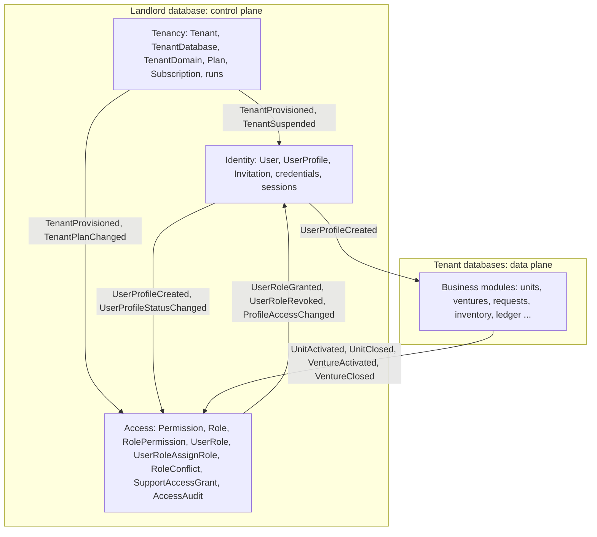
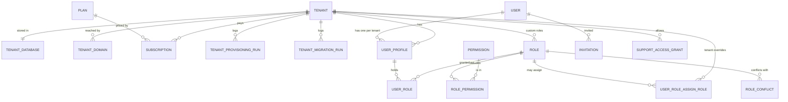
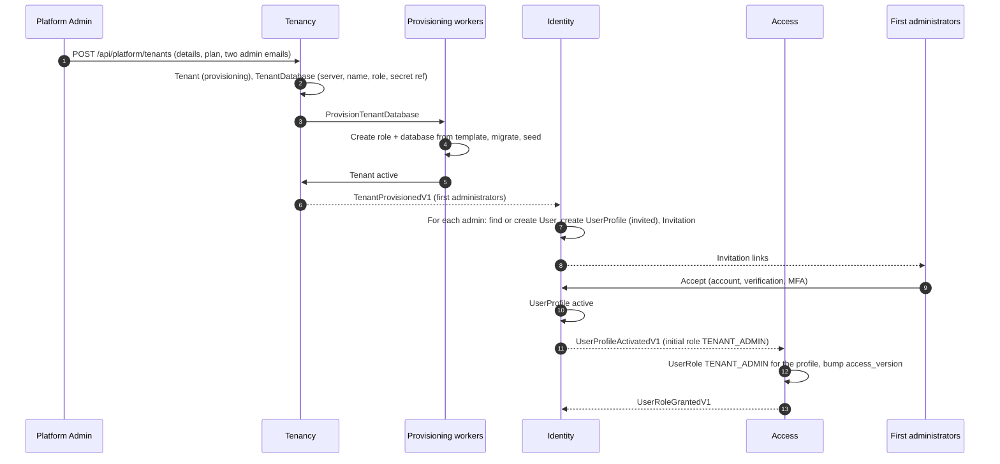
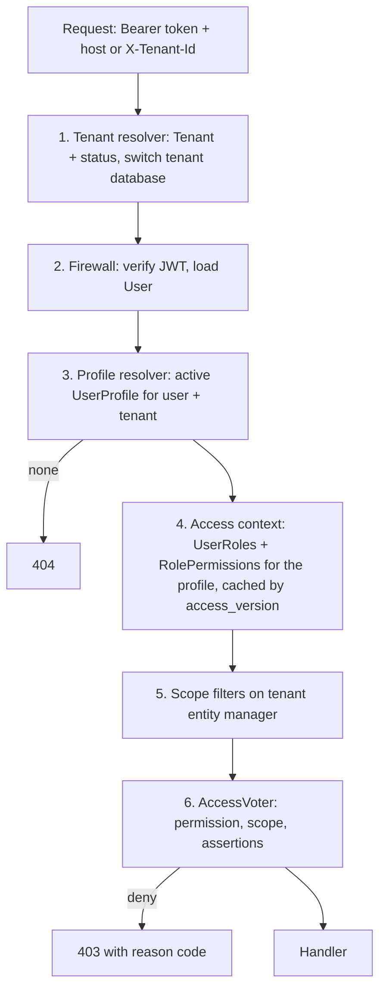
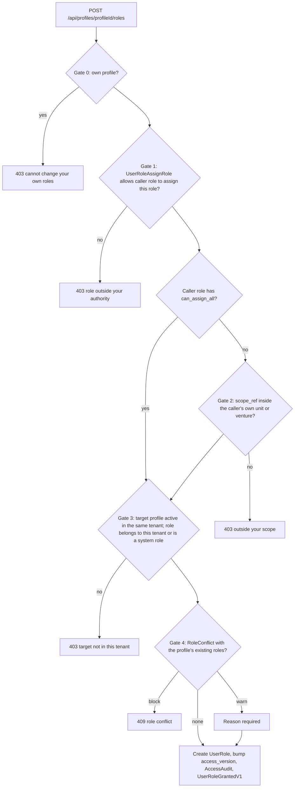

# User, access control and tenancy: architecture (Profile pattern)

**Owner:** lead backend engineering · **Applies to:** the Tenancy, Identity and Access modules and every protected endpoint · **Pattern:** REPROMAS `ACCESS_ROLES_PERMISSIONS.md` (global User, per-tenant Profile, RBAC, role scopes, delegated assignment), adapted to database-per-tenant and event-only modules

**The model in one sentence:** a global **User** gets one **UserProfile** per tenant (society); the profile is how we know which societies a user belongs to; **UserRole** grants catalogue **Roles** to a profile; **RolePermission** gives each role its catalogue **Permissions**; **UserRoleAssignRole** says which roles a role holder may assign; the landlord also holds **Tenant**, **TenantDatabase** and the rest of the tenancy registry.

Out of scope here (section 21): the **approval workflow** (its own module, plugging in through assertions) and **cooperative membership**.

## 1. Key decisions

| Topic | Decision | Why |
| --- | --- | --- |
| Where identity and access live | **Landlord database** (the control plane): Tenant registry, User, UserProfile, Role, Permission, RolePermission, UserRole, UserRoleAssignRole | One source of truth across societies; login, society switcher and access checks need no tenant database; platform roles fit the same model |
| Where business data lives | **Each tenant database** (the data plane): business units, ventures, requests, ledger … | Isolation, per-society restore and erasure (Multi-tenancy tab) |
| How a user belongs to a society | **UserProfile** `(user_id, tenant_id)`, unique per pair | REPROMAS Profile pattern; the profile carries status and per-society details |
| What a role is granted to | The **profile**, not the user | A grant can only exist inside a society the user belongs to; removing the profile ends every role in that society |
| Role catalogue | **System roles** are global (`tenant_id` null), defined by the platform and shared by all tenants; **custom roles** belong to one tenant | No per-tenant copies to keep in sync; tenants still tailor roles |
| Permission catalogue | **Global only**, generated from code | One list; plan limits handled by an assertion, not by per-tenant copies |
| Tokens | No roles or permissions in the JWT; access loaded per request and cached by `access_version` | Instant revocation (Authentication tab) |
| Module boundaries | Tenancy, Identity and Access are separate modules with separate schemas in the landlord; they exchange events and keep small projections | Event-only rule; no cross-module foreign keys |
| Business rules on records | **Assertions** registered by the owning module | Object- and state-based checks, and the hook for the approval module |

This moves the Access tables from the tenant databases (previous version of this tab and section 3 of the Multi-tenancy tab) to the landlord. Tenant databases keep only business data plus a read-only projection of profile names where modules need to display them.

**Alignment with the Authentication tab.** Authentication (how people and systems prove who they are) is specified in the *Authentication: JWT, OAuth2 and users* tab; this tab follows it exactly:

| Authentication tab decision | What it means here |
| --- | --- |
| `sub` = User ID; no tenant, profile, roles or permissions in the JWT | The tenant comes from the host or `X-Tenant-Id`; the profile and access are resolved on the server (section 12) |
| Access token 10 minutes; refresh token per **User**, rotating, 14 days, 30-day cap | One sign-in covers all of a user's societies; disabling a profile does not touch tokens, the profile check blocks that society at once |
| User `token_version` in the `ver` claim | Bumped by sign-out everywhere, password change, lock and deactivation. Profile and role changes use the profile's `access_version` instead |
| Principals: person, Colsynq staff, service account, webhook sender | Person and staff are Users of `kind = person`; service accounts are Users of `kind = service` with exactly one profile; webhooks are not Users |
| Service accounts authenticate with tenant-bound API keys now, `client_credentials` later | ApiKey belongs to the service User and its tenant; its rights are UserRoles on its profile, through the same gates |
| Social login and external identity providers sign in the **User** through ExternalIdentity | They never create profiles or roles; joining a society is always by invitation |
| MFA for administrators and finance roles, passkeys for staff, step-up for sensitive actions | Enforced by `StepUpAssertion` (section 13) and by role policy |
| `getRoles()` = `ROLE_USER` (+ `ROLE_PLATFORM_STAFF`) | Coarse markers for `access_control` only; every decision uses permission slugs |
| Support staff use a platform profile and a SupportAccessGrant | Section 16 |

## 2. Modules



| Module | Schema | Owns |
| --- | --- | --- |
| **Tenancy** | `tenancy` | Tenant, TenantDatabase, TenantDomain, Plan, Subscription, TenantProvisioningRun, TenantMigrationRun |
| **Identity** | `identity` | User, UserProfile, Invitation, ExternalIdentity, MfaMethod, Passkey, RefreshToken, ApiKey, PasswordResetRequest |
| **Access** | `access` | Permission, Role, RolePermission, UserRole, UserRoleAssignRole, RoleConflict, SupportAccessGrant, AccessAudit, plus projections of profiles and scope references |

Other modules never import these modules. They name permission slugs in API resource attributes and register assertions through shared-kernel interfaces (`PermissionProvider`, `AccessAssertion`).

## 3. Entity–relationship model (landlord)



Links between modules (for example `USER_ROLE.user_profile_id` to Identity's `USER_PROFILE`) are **logical**: stored as UUIDs, kept valid by projections and events, without database foreign keys across schemas. Links inside one module use real foreign keys.

## 4. Tenancy entities

### 4.1 Tenant

| Column | Type | Notes |
| --- | --- | --- |
| `id` | uuid v7 PK |  |
| `slug` | citext unique | Used in subdomains |
| `legal_name`, `short_name` | varchar |  |
| `registration_number`, `registering_authority`, `state` | varchar | Cooperative registration details |
| `status` | enum | `provisioning`, `active`, `suspended`, `archived`, `deleting`, `deleted`, `failed` |
| `failed_step`, `last_error` | varchar, text | Provisioning diagnostics |
| `plan_code` | varchar | Current plan |
| `region` | varchar | Default `ng` |
| `timezone`, `currency` | varchar | `Africa/Lagos`, `NGN` |
| `created_by` | uuid | Platform user |
| `activated_at`, `suspended_at`, `suspension_reason`, `archived_at` |  |  |
| `created_at`, `updated_at` | timestamptz |  |

### 4.2 TenantDatabase

| Column | Type | Notes |
| --- | --- | --- |
| `tenant_id` | uuid PK, FK Tenant | One database per tenant |
| `db_host`, `db_port` | varchar, int | Which server |
| `db_name` | varchar unique | Generated, never user input |
| `db_user` | varchar | Per-tenant runtime role |
| `db_secret_ref` | varchar | Vault path or encrypted secret id, never the password |
| `schema_version`, `schema_status` | varchar | `ok`, `migrating`, `failed`, `drift` |
| `migration_wave` | smallint | 0 canary … 3 last |
| `provisioned_at` | timestamptz |  |

### 4.3 Other tenancy entities

| Entity | Key columns | Purpose |
| --- | --- | --- |
| **TenantDomain** | `host` PK, `tenant_id`, `is_primary`, `verification_token`, `verified_at` | Subdomains and custom domains |
| **Plan** | `code` PK, `name`, `limits` (users, units, ventures, storage), `features` (list of feature codes) | What a tenant may use |
| **Subscription** | `id`, `tenant_id`, `plan_code`, `status`, `period_start`, `period_end` | Billing state |
| **TenantProvisioningRun** | `id`, `tenant_id`, `step`, `status`, `attempt`, `error`, timestamps | One row per provisioning step attempt |
| **TenantMigrationRun** | `id`, `rollout_id`, `tenant_id`, `from_version`, `to_version`, `status`, `duration_ms`, `error` | From `tenants:migrate` |

## 5. Identity entities

### 5.1 User (global)

| Column | Type | Notes |
| --- | --- | --- |
| `id` | uuid v7 PK | Security identifier and JWT `sub` |
| `kind` | enum | `person` or `service` (service accounts, Authentication tab section 11.4) |
| `email` | citext unique, nullable for service | Normalised; login identifier for persons |
| `phone` | varchar unique, nullable | E.164 |
| `password_hash` | varchar(255), nullable | Argon2id; null for service accounts and passkey-only users |
| `status` | enum | `pending_verification`, `active`, `locked`, `deactivated` |
| `token_version` | int | JWT `ver` claim; bumped to sign out everywhere |
| `failed_attempts`, `locked_until` | int, timestamptz | Lockout (never more than 100 failures) |
| `email_verified_at`, `phone_verified_at` | timestamptz |  |
| `mfa_enabled` | bool |  |
| `is_platform_staff` | bool | Colsynq employee; may hold the platform profile; passkey required |
| `last_login_at`, `created_at`, `updated_at` | timestamptz |  |

The User holds **only identity and credentials**. Names and per-society details live on the profile.

### 5.2 UserProfile (per tenant)

| Column | Type | Notes |
| --- | --- | --- |
| `id` | uuid v7 PK | Referenced by UserRole |
| `user_id` | uuid FK User |  |
| `tenant_id` | uuid, nullable | **Null = platform profile** (Colsynq staff); otherwise the society |
| `first_name`, `last_name`, `display_name` | varchar | As known in this society |
| `phone`, `email` | varchar, nullable | Contact in this society, if different |
| `staff_number` / `reference` | varchar, nullable | Society's own reference |
| `status` | enum | `invited`, `active`, `disabled`, `removed` |
| `access_version` | int | Bumped on any change to this profile's rights; cache key |
| `invited_by`, `joined_at`, `disabled_at`, `removed_at`, `status_reason` |  |  |
| `metadata` | jsonb, nullable | Society-specific fields |
| `created_at`, `updated_at` | timestamptz |  |

Constraints: unique `(user_id, tenant_id)` where `tenant_id` is not null; unique `(user_id)` where `tenant_id` is null (one platform profile).

**"Which societies does this user belong to?"** → their active profiles. **"Is this user allowed into society S?"** → an active profile for S.

### 5.3 Other identity entities

| Entity | Key columns | Purpose (Authentication tab section) |
| --- | --- | --- |
| **Invitation** | `id`, `tenant_id`, `email_or_phone`, `token_hash`, `initial_role_id`, `initial_scope_ref_id`, `invited_by_profile_id`, `expires_at`, `accepted_at`, `revoked_at` | Only way to join a society for now; single use, 72 hours (12) |
| **ExternalIdentity** | `id`, `user_id`, `provider`, `subject` (unique with provider), `email`, `email_verified`, `linked_at`, `last_used_at`, `unlinked_at` | Social login, external identity provider users and `client_credentials` clients mapped to a User (11.1) |
| **MfaMethod** | `id`, `user_id`, `type` (`totp`, `email`), `secret_encrypted`, `confirmed_at`, `trusted_device_version` | scheb 2fa; secrets encrypted at rest (12) |
| **BackupCode** | `user_id`, `code_hash`, `used_at` | Hashed with the `recovery_code` hasher |
| **Passkey** | WebAuthn credential source: `credential_id`, `public_key`, `user_handle` (UUID bytes), `sign_count`, `transports`, `created_at`, `last_used_at` | Required for platform staff (12) |
| **RefreshToken** | gesdinet entity: hashed token, `username` (= User ID), `valid`, `family`, `family_valid` | Per **User**, not per profile (8) |
| **ApiKey** | `id`, `user_id` (service User), `tenant_id`, `name`, `prefix`, `lookup_hash` (SHA-256), `ip_allow_list`, `expires_at`, `last_used_at`, `revoked_at`, `created_by_profile_id` | Service account keys, bound to one tenant (11.4) |
| **PasswordResetRequest** | `selector`, `hashed_token`, `user_id`, `requested_at`, `expires_at` | reset-password-bundle (12) |

The JWT blocklist (`jti`) and refresh reuse cache live in Redis, not in tables.

## 6. Access entities

### 6.1 Permission (catalogue)

| Column | Type | Notes |
| --- | --- | --- |
| `id` | uuid v7 PK |  |
| `slug` | varchar(150) unique | `resource:action`, e.g. `purchase-orders:create` |
| `resource`, `action` | varchar | Split for filtering |
| `module` | varchar | Owning module |
| `name`, `description` | varchar | For the role editor |
| `risk` | enum | `low`, `high` (personal data, configuration, access), `money` (moves or commits funds) |
| `allowed_scopes` | varchar\[\] | Scopes this permission may be granted with |
| `feature_code` | varchar, nullable | Plan feature it belongs to |
| `is_platform` | bool | Only for platform roles |
| `deprecated_at` | timestamptz, nullable | Removed from code; kept one release |

Global and generated from code (section 8). Tenants never edit it.

### 6.2 Role (catalogue)

| Column | Type | Notes |
| --- | --- | --- |
| `id` | uuid v7 PK |  |
| `tenant_id` | uuid, nullable | **Null = system role** shared by all tenants; set = custom role of one tenant |
| `code` | varchar | Unique per `tenant_id` (system codes unique globally) |
| `name`, `description` | varchar |  |
| `scope` | enum `RoleScope` | Where it can be granted (section 7) |
| `is_system` | bool | System roles are read-only for tenants |
| `is_platform` | bool | Platform roles, granted only to platform profiles |
| `can_assign_all` | bool | Wildcard for UserRoleAssignRole (tenant administrators) |
| `based_on_role_id` | uuid, nullable | Custom role copied from a system role |
| `archived_at` | timestamptz, nullable | Archived roles cannot be granted; existing grants end |
| `created_by_profile_id`, `created_at`, `updated_at` |  |  |

### 6.3 RolePermission (assigning permissions to a role)

| Column | Type | Notes |
| --- | --- | --- |
| `role_id` | uuid FK Role |  |
| `permission_id` | uuid FK Permission |  |
| `granted_by_profile_id`, `granted_at` |  | Audit |

Primary key `(role_id, permission_id)`. Rules: a permission is added only if its `allowed_scopes` includes the role's scope; platform permissions only to platform roles; system roles' permissions are changed only by the platform (catalogue release); `high` and `money` permissions are never added automatically.

### 6.4 UserRole (granting a role to a profile)

| Column | Type | Notes |
| --- | --- | --- |
| `id` | uuid v7 PK |  |
| `user_profile_id` | uuid | The profile, hence the user **and** the tenant |
| `tenant_id` | uuid, nullable | Copied from the profile for indexing and checks; null for platform roles |
| `role_id` | uuid FK Role | System role or a custom role of the same tenant |
| `scope` | enum `RoleScope` | Equals the role's scope |
| `scope_ref_id` | uuid, nullable | Business unit or venture ID in the tenant database; the user ID for SELF; null for TENANT and PLATFORM |
| `granted_by_profile_id`, `granted_at` |  |  |
| `expires_at` | timestamptz, nullable | Required for time-limited roles |
| `revoked_at`, `revoked_by_profile_id`, `revoke_reason` |  | Rows are never deleted |

Unique active grant per `(user_profile_id, role_id, scope_ref_id)`. A grant is valid only while the profile is `active`, the role is not archived, and `expires_at` has not passed.

### 6.5 UserRoleAssignRole (who may assign which role)

The authority matrix: holders of role **A** may assign role **B**.

| Column | Type | Notes |
| --- | --- | --- |
| `id` | uuid v7 PK |  |
| `tenant_id` | uuid, nullable | **Null = default edge** for all tenants (between system roles); set = tenant's own edge |
| `assigner_role_id` | uuid FK Role | Role A |
| `assignable_role_id` | uuid FK Role | Role B |
| `created_by_profile_id`, `created_at` |  |  |

Unique `(tenant_id, assigner_role_id, assignable_role_id)`. A tenant may add edges for its custom roles and may **disable** a default edge through `access.tenant_edge_override (tenant_id, edge_id, disabled)`. Holders of a role with `can_assign_all` may assign any non-platform role in their tenant.

### 6.6 Supporting access entities

| Entity | Key columns | Purpose |
| --- | --- | --- |
| **RoleConflict** | `id`, `tenant_id` (nullable = default), `role_a_id`, `role_b_id`, `same_scope_only`, `severity` (`block`, `warn`) | Static separation of duties (section 15) |
| **SupportAccessGrant** | `id`, `tenant_id`, `support_profile_id`, `granted_by_profile_id`, `reason`, `ticket_ref`, `mode`, `starts_at`, `expires_at`, `revoked_at` | Time-boxed support access (section 16) |
| **AccessAudit** | `id`, `tenant_id`, `actor_profile_id`, `action`, `target_profile_id`, `role_id`, `before`, `after`, `reason`, `occurred_at` | Append-only record of every access change |
| **ProfileProjection** | `user_profile_id`, `user_id`, `tenant_id`, `status`, `display_name` | Access's local copy of Identity's profiles (event-fed) |
| **ScopeReferenceProjection** | `tenant_id`, `scope_ref_id`, `kind` (`business_unit`, `venture`), `name`, `status` | Valid unit and venture IDs, fed by tenant module events |

## 7. Role scopes (`RoleScope`)

| Scope | Rank | `scope_ref_id` | Applies to | Example roles |
| --- | --- | --- | --- | --- |
| `PLATFORM` | −1 | null | Colsynq platform; platform profiles only | Platform Owner, Platform Admin, Support Agent |
| `TENANT` | 0 | null | The whole society | Tenant Administrator, Finance Officer, Accountant, Auditor, Viewer |
| `BUSINESS_UNIT` | 1 | business unit ID | One business unit | Unit Manager, Storekeeper, Cashier, Procurement Officer |
| `VENTURE` | 1 | venture ID | One venture | Venture Manager, Venture Accountant |
| `SELF` | 2 | the user's ID | Records owned by the user | Self-service User |

```php
enum RoleScope: string
{
    case Platform = 'PLATFORM';
    case Tenant = 'TENANT';
    case BusinessUnit = 'BUSINESS_UNIT';
    case Venture = 'VENTURE';
    case Self = 'SELF';

    public function requiresReference(): bool
    {
        return match ($this) {
            self::Platform, self::Tenant => false,
            default => true,
        };
    }

    public function rank(): int
    {
        return match ($this) {
            self::Platform => -1,
            self::Tenant => 0,
            self::BusinessUnit, self::Venture => 1,
            self::Self => 2,
        };
    }
}
```

- A TENANT grant covers the whole society, subject to its permissions.
- BUSINESS\_UNIT and VENTURE grants cover records with that reference; several grants give a set of IDs.
- SELF grants cover records whose `owner_user_id` is the user.
- Grants combine by union, **per permission**.

## 8. Permission catalogue

### 8.1 Slugs

Format `resource:action`; resources are kebab-case nouns owned by one module.

| Action | Meaning |
| --- | --- |
| `list` | Browse a collection |
| `read` | View one record |
| `create` | Create |
| `update` | Change |
| `delete` | Archive or remove where allowed (financial records are never deleted) |
| `execute` | Move money or stock, post, release, disburse |
| `export` | Download data (logged) |
| `manage` | Configure or administer |

Approval permissions will be defined by the approval module.

### 8.2 Declared in code, synced on deploy

```php
interface PermissionProvider                     // shared kernel
{
    /** @return list<PermissionDefinition> */
    public function permissions(): array;
}

#[AutoconfigureTag('colsynq.permission_provider')]
final class ProcurementPermissions implements PermissionProvider   // example module
{
    public function permissions(): array
    {
        return [
            PermissionDefinition::of('purchase-orders', ['list', 'read', 'create', 'update'], risk: 'low',
                scopes: [RoleScope::Tenant, RoleScope::BusinessUnit], feature: 'procurement'),
            PermissionDefinition::of('supplier-invoices', ['execute'], risk: 'money',
                scopes: [RoleScope::Tenant], feature: 'procurement'),
        ];
    }
}
```

`access:catalogue:sync` runs on every deploy:

1. Collects all providers and upserts **Permission** rows; marks missing slugs `deprecated_at`.
2. Applies the **system role definitions** (also in code, `SystemRoleCatalogue`) to Role and RolePermission for `tenant_id IS NULL`, and the default UserRoleAssignRole and RoleConflict edges.
3. Adds new `low` permissions to system roles only if their definition lists them. `high` and `money` permissions are added to system roles only by an explicit change in `SystemRoleCatalogue`, reviewed in code.
4. Removes deprecated permissions from roles one release after deprecation, with an AccessAudit entry.
5. Bumps `access_version` for affected profiles (or a global catalogue version that is part of the cache key).

Because system roles are shared, a catalogue release changes every tenant at once, with no per-tenant sync jobs.

### 8.3 Plan features

A permission with a `feature_code` works only when the tenant's plan includes that feature. This is enforced by the built-in `PlanFeatureAssertion` (section 13), not by copying permissions per tenant.

## 9. Role catalogue: system roles

| Role code | Scope | Main permissions | Notes |
| --- | --- | --- | --- |
| `TENANT_ADMIN` | TENANT | Roles, role permissions, user roles, assign-role matrix, role conflicts, profiles, invitations, tenant settings and domains, support grants; read of all modules | `can_assign_all`. **No `money` permissions** |
| `FINANCE_OFFICER` | TENANT | `money` execute permissions; read ledger and reconciliation | Conflicts with Auditor |
| `ACCOUNTANT` | TENANT | Journals, statements, reconciliation; read finance |  |
| `AUDITOR` | TENANT | Read and export everything, including access audit | No create, update, delete or execute |
| `EXTERNAL_AUDITOR` | TENANT | Read and export finance | `expires_at` required |
| `VIEWER` | TENANT | Read non-sensitive resources |  |
| `UNIT_MANAGER` | BUSINESS\_UNIT | Unit operations; may assign unit roles in own unit |  |
| `STOREKEEPER` | BUSINESS\_UNIT | Goods received, stock movements and counts, deliveries |  |
| `CASHIER` | BUSINESS\_UNIT | Sales, refunds, cash-ups, petty cash |  |
| `PROCUREMENT_OFFICER` | BUSINESS\_UNIT | Suppliers, quotations, purchase orders | Conflicts with Storekeeper, same unit |
| `VENTURE_MANAGER` | VENTURE | Venture operations and KPIs; may assign venture roles in own venture |  |
| `VENTURE_ACCOUNTANT` | VENTURE | Venture journals and returns |  |
| `SELF_SERVICE` | SELF | `me-*`; own records where a module offers self-service | Granted when a profile becomes active, if the tenant enables it |
| `PLATFORM_OWNER` | PLATFORM | All platform permissions | Two holders minimum |
| `PLATFORM_ADMIN` | PLATFORM | `tenants:*`, `plans:*`, platform profiles |  |
| `SUPPORT_AGENT` | PLATFORM | Platform read; tenant data only under a support grant |  |
| `COMPLIANCE_OFFICER` | PLATFORM | Tenant registration details, platform audit |  |
| `FINANCE_OPERATIONS` | PLATFORM | Plans, subscriptions, billing |  |

**Default UserRoleAssignRole edges:** `UNIT_MANAGER` → `STOREKEEPER`, `CASHIER`, `PROCUREMENT_OFFICER`, `SELF_SERVICE`; `VENTURE_MANAGER` → `VENTURE_ACCOUNTANT`, `SELF_SERVICE`; `PLATFORM_OWNER` → all platform roles; `PLATFORM_ADMIN` → `SUPPORT_AGENT`, `COMPLIANCE_OFFICER`, `FINANCE_OPERATIONS`. `TENANT_ADMIN` has `can_assign_all` within its tenant.

Tenants create **custom roles** (for example President, Treasurer) by copying a system role (`based_on_role_id`) and adjusting permissions within what the catalogue allows.

## 10. Tenancy lifecycle

### 10.1 Creating a tenant



- Only `tenants:create` holders create tenants. **Two** tenant administrators are always invited.
- No Access rows are created per tenant at provisioning: system roles, permissions and default edges are global already.
- Database provisioning, retries and compensation follow the Multi-tenancy tab.

### 10.2 Tenant status

| Status | Sign-in to the tenant | Reads | Writes | Money actions |
| --- | --- | --- | --- | --- |
| `provisioning` | No | No | No | No |
| `active` | Yes | Yes | Yes | Yes |
| `suspended` | Yes | Yes | No (except subscription payment) | No |
| `archived` | Tenant administrators and auditors | Read-only | No | No |
| `failed` | No | No | No | No |
| `deleting` / `deleted` | No | No | No | No |

The tenant resolver blocks unavailable tenants; the built-in `TenantWritableAssertion` blocks writes for suspended and archived tenants.

## 11. Profile lifecycle

| Step | Identity | Access | Tokens |
| --- | --- | --- | --- |
| **Invite** (`invitations:create`) | Find the User by **verified** email or phone, or create a pending User (`kind = person`); create UserProfile `invited` and Invitation (optional initial role, checked against the inviter's rights) | — | — |
| **Accept** (password, passkey, social or identity-provider sign-in) | Profile `active`; ExternalIdentity linked if used; `UserProfileActivatedV1` | Projection updated; `SELF_SERVICE` (if enabled) and the initial role granted through the gates (section 14) | Normal sign-in (Authentication tab) |
| **Create service account** (`service-accounts:create`) | Service User (`kind = service`) + its single active profile; first ApiKey shown once | Narrow UserRoles through the gates; never `TENANT_ADMIN` | API key only |
| **Disable** (`profiles:update`) | Profile `disabled` | Grants kept but ignored; `access_version` bumped | **Unchanged**: the profile check refuses this society on the next request; other societies keep working |
| **Enable** | Profile `active` | Grants apply again | Unchanged |
| **Remove** (`profiles:delete`) | Profile `removed`; a service account's keys revoked | All UserRoles of the profile revoked | Unchanged for persons |
| **Lock** (failed sign-ins) or **deactivate** the User | User `locked` or `deactivated`; `token_version` bumped | Deactivation revokes the UserRoles of every profile | Refresh tokens revoked; next request refused |

- An existing user joining another society gets a **new profile**, never a new user.
- The two-administrator rule (section 14.3) applies to disable, remove and deactivate.

## 12. Request pipeline



1. **Tenant resolver:** host or `X-Tenant-Id` → Tenant → status → switch the tenant connection (Multi-tenancy tab). Platform routes (`/api/platform/*`) select the platform profile instead and use no tenant database.
2. **Firewall:** JWT with `sub` = User ID, no roles (Authentication tab).
3. **Profile resolver:** `CurrentProfile` = the active UserProfile for (user, tenant). None → **404**, so outsiders cannot confirm a tenant exists. Support users enter through a valid SupportAccessGrant.
4. **Access context:** one query on the landlord joins UserRole → Role → RolePermission → Permission for the profile, keeping active, unexpired grants of non-archived roles. Cached in Redis as `access:{tenant}:{profile}:{access_version}:{catalogue_version}`.

```php
final readonly class EffectiveAccess
{
    /** @param array<string, list<ScopeGrant>> $grantsBySlug */
    public function __construct(
        public string $userId,
        public string $profileId,
        public ?string $tenantId,
        public array $grantsBySlug,
        public array $roleCodes,
        public int $accessVersion,
    ) {}

    public function covers(string $slug, ?ScopeRef $subject): bool
    {
        foreach ($this->grantsBySlug[$slug] ?? [] as $grant) {
            if ($grant->covers($subject, $this->userId)) {
                return true;
            }
        }
        return false;
    }
}
```

5. **Scope filters** for collections: `business_unit_scope` (`business_unit_id IN (:ids)`), `venture_scope`, `self_scope` (`owner_user_id = :userId`) on entities marked `#[ScopedBy(...)]`; bypassed when the profile holds the list permission at TENANT scope.
6. **AccessVoter:** permission → scope → assertions (section 13).

Clients read their roles for the UI from `GET /api/me/access`; the server always re-checks.

**How each principal enters the pipeline** (Authentication tab sections 3, 7, 10, 11):

| Principal | Step 2 authenticates with | Extra check |
| --- | --- | --- |
| Person | JWT from `/api/auth` (password + MFA, passkey, magic link) | `ver` equals `token_version` |
| Person signed in through an identity provider (later) | Provider's JWT via the `oidc` handler; `sub` mapped through ExternalIdentity | Provider never decides profiles or roles |
| Colsynq staff | JWT; passkey and MFA required | Only the platform profile on `/api/platform/*`; tenant data only through a SupportAccessGrant |
| Service account | `Authorization: ApiKey …` through `ApiKeyHandler` | The key's `tenant_id` must equal the resolved tenant; IP allow-list; expiry |
| Webhook sender | Not authenticated here; Integrations verifies signature, timestamp and replay | Not a User |

## 13. Assertions

A permission says "may update purchase orders in unit X". An **assertion** decides whether it is allowed for **this record, in this state, now**. They are written by the module that owns the record and are the hook for the approval module later.

```php
enum AssertionVote { case Grant; case Deny; case Abstain; }

final readonly class AssertionResult
{
    private function __construct(public AssertionVote $vote, public ?string $reasonCode = null) {}
    public static function grant(): self { return new self(AssertionVote::Grant); }
    public static function abstain(): self { return new self(AssertionVote::Abstain); }
    public static function deny(string $reasonCode): self { return new self(AssertionVote::Deny, $reasonCode); }
}

final readonly class AccessRequest
{
    public function __construct(
        public string $permission,
        public mixed $subject,
        public EffectiveAccess $access,
        public \DateTimeImmutable $now,
    ) {}
}

interface AccessAssertion          // shared kernel; tag colsynq.access_assertion
{
    /** @return list<string> slugs or patterns, e.g. ['journals:update', 'journals:delete'] */
    public static function permissions(): array;

    public function assert(AccessRequest $request): AssertionResult;
}
```

**Order:** permission held → scope covers the subject → every assertion for the slug runs; **any Deny denies**, Grant and Abstain pass. Assertions do not run if the first two fail. The first denial's reason code goes into the 403.

**Rules for assertions:** read-only (no writes, no events), no calls to other modules, fast, deterministic. Domain invariants stay in the aggregates; assertions give a clean 403 before a command runs.

| Assertion | Owner | Permissions | Rule |
| --- | --- | --- | --- |
| `TenantWritableAssertion` | Tenancy | All create, update, delete, execute | Deny when the tenant is suspended or archived |
| `PlanFeatureAssertion` | Tenancy | Permissions with a `feature_code` | Deny when the plan lacks the feature |
| `OwnRecordAssertion` | Access | Grants at SELF scope | Deny unless the subject's owner is the user |
| `NotSelfAssertion` | Access | `user-roles:create`, `user-roles:delete` | Deny changes to one's own roles |
| `StepUpAssertion` | Identity | All `money` and `high` permissions | Deny with `step_up_required` without MFA or recent re-authentication |
| `DraftOnlyAssertion` | Procurement (example) | `purchase-orders:update` | Deny unless draft |
| `PostedJournalIsFinalAssertion` | Ledger (example) | `journals:update`, `journals:delete` | Deny once posted |
| *(later)* approval state | Approval module | Permissions it governs | Deny until the workflow completes |

Outside HTTP (workers, scheduled jobs) code calls `AccessDecision::check($slug, $subject, $profile)`, which runs the same steps.

## 14. Granting and revoking UserRoles (five gates)

Every grant and revoke goes through `UserRoleAssignmentPolicy` in the Access module.



### 14.1 Gates

0. **Own profile:** nobody grants or revokes their own roles, including `can_assign_all` holders.
1. **Authority:** an edge in UserRoleAssignRole (default or tenant) from one of the caller's active roles to the target role, unless the caller's role has `can_assign_all`. Platform roles are assignable only from platform roles.
2. **Scope containment:** a BUSINESS\_UNIT caller assigns only with their own unit IDs; a VENTURE caller only their venture; SELF callers assign nothing; TENANT-scope roles only by `can_assign_all` holders. `scope_ref_id` must exist and be active in ScopeReferenceProjection.
3. **Target and tenant:** the target profile is `active` and belongs to the caller's tenant; the role is a system role or a custom role of the same tenant; the role's scope matches the given reference; time-limited roles have `expires_at`.
4. **Role conflicts:** no `block` conflict with the target's active roles (same scope when `same_scope_only`); a `warn` conflict requires a reason and appears in the auditor's report.

Changing a custom role's permissions (RolePermission) re-runs gate 4 for every holder and is refused if it would create a blocking conflict.

### 14.2 Revocation

- Same gates 0–2: you can revoke only what you could grant.
- Sets `revoked_at`, `revoked_by_profile_id`, `revoke_reason`; bumps `access_version`; AccessAudit; `UserRoleRevokedV1`.
- Effective on the next request (no roles in tokens).

### 14.3 Two-administrator rule

Each tenant keeps at least **two** active profiles holding `TENANT_ADMIN`; the platform keeps two `PLATFORM_OWNER` holders. Revoking the role, disabling or removing the profile, or deactivating the user is refused with `409` if it would go below two.

## 15. Role conflicts (separation of duties)

| Role A | Role B | Same scope only | Severity |
| --- | --- | --- | --- |
| `FINANCE_OFFICER` | `AUDITOR` | no | block |
| `FINANCE_OFFICER` | `EXTERNAL_AUDITOR` | no | block |
| `TENANT_ADMIN` | `FINANCE_OFFICER` | no | warn |
| `CASHIER` | `ACCOUNTANT` / `VENTURE_ACCOUNTANT` | yes | block |
| `PROCUREMENT_OFFICER` | `STOREKEEPER` | yes | block |

Defaults have `tenant_id` null. Tenants add their own; changing a default from `block` to `warn` for a tenant needs `role-conflicts:manage` and a reason, and is published for the auditor. Rules about who may act on a particular transaction (maker and checker) belong to the approval module.

## 16. Platform staff and support access

- Colsynq staff have a **platform profile** (`tenant_id` null) holding platform roles. A platform role gives no access to tenant data.
- A tenant administrator creates a **SupportAccessGrant** for a named support profile: reason, ticket, `read_only` or `impersonate`, up to 4 hours. Support cannot create grants for themselves.
- **Emergency access** (for example, both administrators locked out): `PLATFORM_OWNER` only, MFA and passkey, reason recorded, tenant administrators notified at once, read-only, 1 hour.
- During a grant the support profile acts with a temporary TENANT-scope role; impersonation follows the Authentication tab (no money actions, no access changes, no exports, both identities recorded).

## 17. Code layout

```
src/
├── Tenancy/
│   ├── Domain/Model/          Tenant, TenantDatabase, TenantDomain, Plan, Subscription, TenantStatus
│   ├── Domain/Port/           TenantRepository, TenantDatabaseRepository
│   ├── Application/Command/   CreateTenant, SuspendTenant, ReactivateTenant, ArchiveTenant, ChangePlan, AddDomain
│   ├── Application/Provisioning/  ProvisionTenantDatabase, MigrateTenantDatabase, SeedTenant, MarkTenantActive
│   ├── Application/Assertion/ TenantWritableAssertion, PlanFeatureAssertion
│   ├── Contracts/Event/       TenantCreatedV1, TenantProvisionedV1, TenantSuspendedV1 ...
│   └── Infrastructure/        Doctrine XML mapping, TenantResolver, TenantContext, DBAL middleware, API resources
├── Identity/
│   ├── Domain/Model/          User, UserProfile, Invitation, ProfileStatus
│   ├── Application/Command/   InviteToTenant, AcceptInvitation, DisableProfile, EnableProfile, RemoveProfile, DeactivateUser
│   ├── Application/Assertion/ StepUpAssertion
│   ├── Contracts/Event/       UserRegisteredV1, UserProfileCreatedV1, UserProfileActivatedV1 ...
│   └── Infrastructure/        SecurityUser adapter, user provider, CurrentProfile resolver, JWT listeners
├── Access/
│   ├── Domain/Model/          Permission, Role, RolePermission, UserRole, UserRoleAssignRole, RoleConflict, RoleScope
│   ├── Domain/Policy/         UserRoleAssignmentPolicy (gates), RoleConflictPolicy, TwoAdministratorRule
│   ├── Application/           Commands, EffectiveAccessLoader, AccessDecision, catalogue sync, projections
│   ├── Contracts/Event/       UserRoleGrantedV1, UserRoleRevokedV1, ProfileAccessChangedV1 ...
│   └── Infrastructure/        AccessVoter, scope filters, assertion registry, API resources
└── Shared/
    └── Access/                PermissionProvider, PermissionDefinition, AccessAssertion, AccessRequest,
                               AssertionResult, RoleScope, ScopedBy attribute, AccessDecision interface
```

**Aggregates:** Tenant (with TenantDatabase as its own aggregate for credentials), User, UserProfile, Role (owns its RolePermissions), UserRole, UserRoleAssignRole, RoleConflict. Permission is a catalogue entity written only by the sync command.

## 18. API endpoints

### 18.1 Platform (`/api/platform`, platform profile)

| Method | Endpoint | Permission |
| --- | --- | --- |
| `POST` / `GET` | `/api/platform/tenants` | `tenants:create` / `tenants:list` |
| `GET` / `PATCH` | `/api/platform/tenants/{id}` | `tenants:read` / `tenants:update` |
| `POST` | `/api/platform/tenants/{id}/suspend`, `/reactivate`, `/archive`, `/delete` | `tenants:manage` / `tenants:delete` |
| `POST` | `/api/platform/tenants/{id}/retry-provisioning`, `/move` | `tenants:manage` |
| `GET` | `/api/platform/tenants/{id}/database` | `tenant-databases:read` (no secrets returned) |
| `GET` | `/api/platform/migration-runs` | `migration-runs:list` |
| `GET` / `POST` | `/api/platform/plans` | `plans:list` / `plans:manage` |
| `GET` | `/api/platform/permissions`, `/api/platform/roles` | `permissions:list`, `roles:list` |
| `GET` / `POST` / `DELETE` | `/api/platform/profiles/{profileId}/roles` | `platform-user-roles:*` |

### 18.2 Tenant settings

| Method | Endpoint | Permission |
| --- | --- | --- |
| `GET` / `PATCH` | `/api/tenant` | `tenant:read` / `tenant:manage` |
| `GET` / `POST` / `DELETE` | `/api/tenant/domains` | `tenant-domains:manage` |
| `POST` | `/api/tenant/domains/{host}/verify` | `tenant-domains:manage` |

### 18.3 Profiles (users of the tenant)

| Method | Endpoint | Permission | Notes |
| --- | --- | --- | --- |
| `GET` | `/api/profiles` | `profiles:list` | Filter by status and role; scoped callers see profiles holding roles in their scope |
| `GET` / `PATCH` | `/api/profiles/{id}` | `profiles:read` / `profiles:update` | Names, reference, disable or enable with reason |
| `DELETE` | `/api/profiles/{id}` | `profiles:delete` | Remove from tenant; two-administrator rule |
| `GET` / `POST` / `DELETE` | `/api/invitations` | `invitations:*` | `{emailOrPhone, firstName, lastName, initialRoleId?, scopeRefId?}` |
| `POST` | `/api/invitations/{token}/accept` | invited person (public, rate-limited) |  |

### 18.4 Roles and permissions

| Method | Endpoint | Permission | Notes |
| --- | --- | --- | --- |
| `GET` | `/api/permissions` | `permissions:list` | Catalogue, filtered to the tenant's plan, with risk and allowed scopes |
| `GET` | `/api/roles` | `roles:list` | System roles plus the tenant's custom roles; `?assignableOnly=1` |
| `GET` | `/api/roles/{id}` | `roles:read` | `?include=permissions` |
| `POST` | `/api/roles` | `roles:create` | Custom role: `{code, name, scope, description, basedOnRoleId?}` |
| `PATCH` / `DELETE` | `/api/roles/{id}` | `roles:update` / `roles:delete` | Custom roles only; delete archives |
| `PUT` | `/api/roles/{id}/permissions` | `role-permissions:manage` | RolePermission set; custom roles only; conflict re-check |
| `GET` / `POST` / `DELETE` | `/api/user-role-assign-roles` | `user-role-assign-roles:*` | Tenant edges and overrides of defaults |
| `GET` / `POST` / `PATCH` | `/api/role-conflicts` | `role-conflicts:list` / `role-conflicts:manage` |  |

### 18.5 UserRoles

| Method | Endpoint | Permission | Notes |
| --- | --- | --- | --- |
| `GET` | `/api/profiles/{profileId}/roles` | `user-roles:list` |  |
| `POST` | `/api/profiles/{profileId}/roles` | `user-roles:create` | `{roleId, scopeRefId?, expiresAt?, reason}`; five gates |
| `DELETE` | `/api/profiles/{profileId}/roles/{userRoleId}` | `user-roles:delete` | `{reason}`; two-administrator rule |
| `GET` | `/api/access-audit` | `access-audit:read` |  |
| `GET` / `POST` / `DELETE` | `/api/support-access-grants` | `support-access-grants:*` |  |

### 18.6 Me

| Method | Endpoint | Returns |
| --- | --- | --- |
| `GET` / `PATCH` | `/api/me` | User (email, phone, MFA status) |
| `GET` | `/api/me/profiles` | Active profiles with tenant name and status: the society switcher |
| `GET` / `PATCH` | `/api/me/profile` | The current tenant's profile |
| `GET` | `/api/me/access` | Current tenant: roles with scope and unit or venture name, permission slugs, `access_version` |
| `GET` / `DELETE` | `/api/me/sessions` | Devices and sign-out |

### 18.7 Authentication (Identity, from the Authentication tab)

| Method | Endpoint | Access | Notes |
| --- | --- | --- | --- |
| `POST` | `/api/auth` | public, throttled | Email and password; returns access token and refresh token (cookie or body); MFA step when required |
| `POST` | `/api/auth/mfa` | MFA-pending | Complete the second factor (verify flow) |
| `POST` | `/api/token/refresh` | refresh token | Rotates the refresh token |
| `POST` | `/api/logout` | authenticated | Blocklists the current token, revokes its refresh token |
| `POST` | `/api/password-reset`, `/api/password-reset/{token}` | public, throttled | Uniform responses |
| `POST` | `/api/verify-email` | public | Signed link |
| `POST` | `/login/options`, `/login` | public | Passkey sign-in (WebAuthn bundle routes) |
| `GET` / `POST` / `DELETE` | `/api/me/mfa`, `/api/me/passkeys` | authenticated, step-up | Manage second factors |
| `GET` / `POST` / `DELETE` | `/api/me/external-identities` | authenticated, step-up | Link or unlink social and identity-provider sign-in |
| `POST` | `/api/me/sessions/revoke-all` | authenticated, step-up | Sign out everywhere (`token_version` bump) |

### 18.8 Service accounts

| Method | Endpoint | Permission | Notes |
| --- | --- | --- | --- |
| `GET` / `POST` | `/api/service-accounts` | `service-accounts:list` / `service-accounts:create` | Creates the service User and its profile |
| `POST` | `/api/service-accounts/{profileId}/api-keys` | `api-keys:create` (step-up) | Returns the key once |
| `DELETE` | `/api/service-accounts/{profileId}/api-keys/{keyId}` | `api-keys:delete` | Immediate effect |
| Roles | `/api/profiles/{profileId}/roles` | `user-roles:*` | Same gates as people |

## 19. Events

| Event (V1) | Producer | Consumers | Key payload |
| --- | --- | --- | --- |
| `TenantCreatedV1` | Tenancy | Audit, Notification | tenantId, name, plan |
| `TenantProvisionedV1` | Tenancy | Identity, Access | tenantId, firstAdministrators\[\] |
| `TenantProvisioningFailedV1` | Tenancy | Monitoring | tenantId, step, error |
| `TenantActivatedV1`, `TenantSuspendedV1`, `TenantReactivatedV1`, `TenantArchivedV1`, `TenantDeletedV1` | Tenancy | Identity, Access, all modules | tenantId, reason |
| `TenantPlanChangedV1` | Tenancy | Access, feature modules | tenantId, plan, features, limits |
| `UserRegisteredV1`, `UserDeactivatedV1` | Identity | Access, Audit | userId |
| `UserProfileCreatedV1` | Identity | Access, tenant modules (display names) | profileId, userId, tenantId, displayName, status |
| `UserProfileActivatedV1` | Identity | Access | profileId, initialRoleId?, scopeRefId? |
| `UserProfileStatusChangedV1` | Identity | Access | profileId, status, reason |
| `UserProfileUpdatedV1` | Identity | Tenant modules | profileId, displayName |
| `UserRoleGrantedV1`, `UserRoleRevokedV1` | Access | Identity (notifications), Audit | profileId, roleCode, scope, scopeRefId, by, reason |
| `ProfileAccessChangedV1` | Access | Identity, Reporting | profileId, accessVersion |
| `RoleCreatedV1`, `RolePermissionsChangedV1`, `RoleArchivedV1` | Access | Audit | roleId, tenantId, added, removed |
| `RoleConflictChangedV1` | Access | Audit | rule, severity, reason |
| `PermissionCatalogueChangedV1` | Access | Monitoring | version, added, deprecated |
| `SupportAccessGrantedV1`, `SupportAccessEndedV1` | Access | Notification, Audit | tenantId, supportProfileId, mode, expiresAt |

Access also consumes `UnitActivatedV1`, `UnitClosedV1`, `VentureActivatedV1`, `VentureClosedV1` from tenant modules (with tenant stamp) for ScopeReferenceProjection; closing a unit or venture revokes grants scoped to it.

**Authentication events** (Identity, from the Authentication tab section 15): `EmailVerifiedV1`, `PasswordChangedV1`, `UserLockedV1`, `UserUnlockedV1`, `UserSignedInV1`, `SignInFailedV1`, `SessionsRevokedV1`, `RefreshTokenReuseDetectedV1`, `MfaEnabledV1`, `MfaDisabledV1`, `PasskeyAddedV1`, `ExternalIdentityLinkedV1`, `ServiceAccountCreatedV1`, `ApiKeyCreatedV1`, `ApiKeyRevokedV1`. Consumers: Audit and Notification; Access consumes `UserDeactivatedV1` and `ServiceAccountCreatedV1` (projection).

## 20. Errors and caching

| Situation | HTTP | Code |
| --- | --- | --- |
| Unknown tenant, or no active profile in it | 404 | `tenant_not_found` |
| Tenant not ready | 503 | `tenant_unavailable` |
| Tenant suspended or archived (write) | 403 | `tenant_read_only` |
| Missing permission or outside scope | 403 | `access_denied` |
| Assertion denied | 403 | the assertion's reason code |
| Gate failure | 403 | `user_role_forbidden` with gate number |
| Role conflict | 409 | `role_conflict` |
| Fewer than two administrators would remain | 409 | `last_administrators` |
| MFA or recent re-authentication needed | 401 | `step_up_required` |

- Access context cached per `(tenant, profile, access_version, catalogue_version)`; any grant, revoke, role-permission change, profile status change, role archive or catalogue release changes a version.
- Expired grants are ignored by the loader even before clean-up runs.
- Projections can only make a gate **refuse** until they catch up, never allow a wrong grant.
- Assertions read live state and are not cached across requests.

## 21. Out of scope for now

| Topic | Plan |
| --- | --- |
| **Approval workflow** | A dedicated service and module (definitions, steps, approvers, thresholds, maker–checker). It plugs in through assertions and defines its own permissions |
| **Cooperative membership** | Members, staff, employers, admission and exit. A UserProfile will later link to a member record |
| **Governance** | Elections, resolutions, office handovers, periodic access recertification |

## 22. Governance tests

| Test | Asserts |
| --- | --- |
| `PermissionCatalogCoverageTest` | Every API operation has a `security` expression with a catalogued slug, or is public by list |
| `SystemRoleCatalogueTest` | System roles reference only existing permissions within their allowed scopes; no `money` permission on `TENANT_ADMIN` |
| `ProfileUniquenessTest` | One profile per user and tenant; one platform profile per user |
| `UserRoleAssignmentPolicyTest` | Each gate allows and denies correctly, including `can_assign_all`, tenant overrides and platform roles |
| `RoleConflictTest` | Block and warn on grant and on role-permission change |
| `TwoAdministratorsTest` | Revoke, disable, remove and deactivate keep two administrators |
| `AssertionRegistryTest` / `AssertionEvaluationTest` | Assertions target existing slugs, are read-only, deny wins, reason codes reach the 403 |
| `ScopeDeclarationTest` | Entities with unit, venture or owner columns carry `#[ScopedBy]` and are filtered |
| `NoRolesInTokenTest` | JWTs contain no roles or permissions |
| `CrossTenantTest` | A profile of tenant A gets 404 in tenant B; caches never mix |
| `RevocationTimingTest` | A revoked role stops working on the next request |
| `SupportAccessTest` | No tenant data without a valid grant; impersonation limits |
| `InvitationTest` | Existing users get a new profile, not a new user; initial role checked against the inviter |

These run together with the authentication negative tests in the Authentication tab (section 17), including: valid token but no profile in the requested tenant (404), a disabled profile in one society while another still works, an API key used with another tenant, and a service account attempting password sign-in.

## 23. Changes to other tabs

- **Authentication tab:** aligned. It uses User, UserProfile, service accounts, ExternalIdentity, `X-Tenant-Id` and the same request pipeline; this tab owns the data model and authorisation, that tab owns sign-in, tokens and integrations.
- **Multi-tenancy tab, section 3:** still to update: Access tables live in the landlord (`access` schema), not in tenant databases; tenant databases hold a read-only profile-name projection.
- **Architecture guide:** still to update: Tenancy, Identity and Access listed as landlord modules.

## 24. Checklist for new features

- [ ] Permissions declared in the module's `PermissionProvider` with risk, allowed scopes and feature
- [ ] Every operation has a `security` expression; collections use scope filters; entities carry `#[ScopedBy]`
- [ ] State and ownership rules written as assertions in the owning module, mirrored by domain invariants
- [ ] System role changes made in `SystemRoleCatalogue` and reviewed; `money` permissions never added automatically
- [ ] New events listed in section 19 with schemas
- [ ] Governance tests updated
